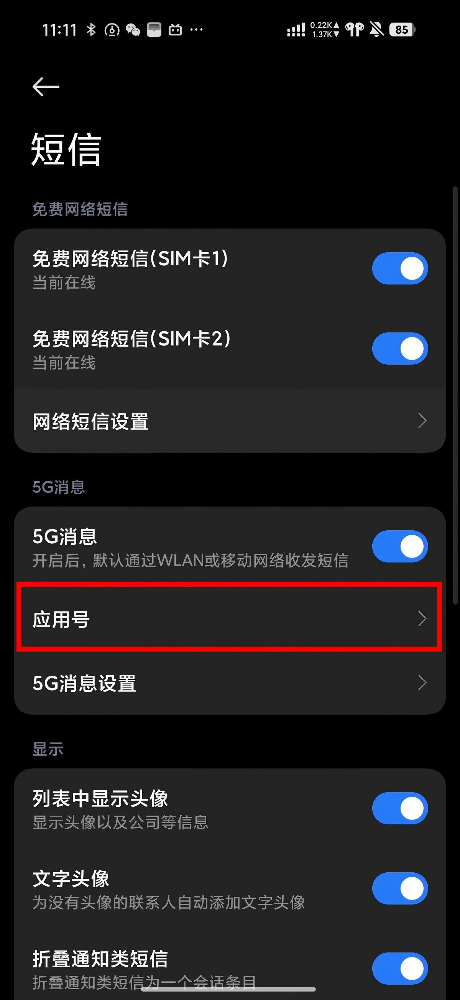
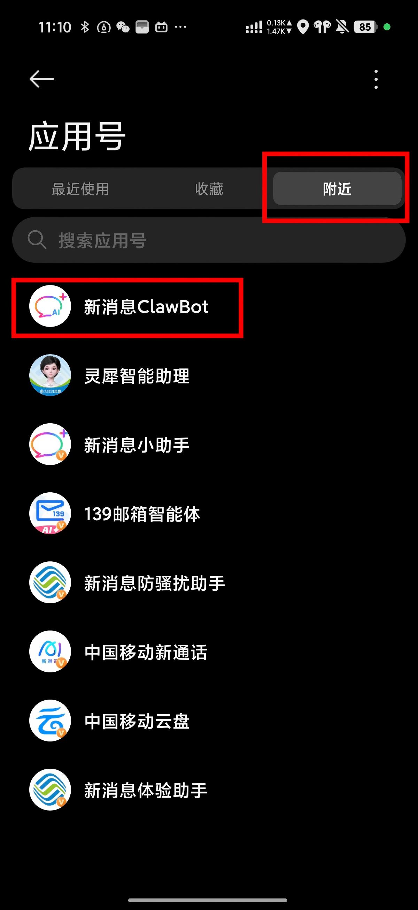
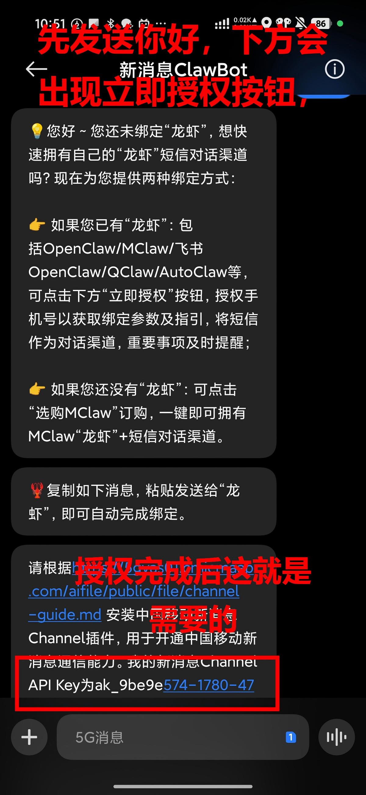

# 通知

代理跑完了、某个号失败了，让 AUTO-MAS 发消息告诉你。可在通知设置中选择邮件、Server 酱、企业微信机器人、中国移动新消息等渠道。

## 两级通知：全局和账号

::: info 示例版本与演示范围
本节界面基于 **AUTO-MAS v5.8.0-beta.3**。示例账号和收件地址用于演示，未向外部发送通知。
:::

### 全局通知：先打开渠道，再填写配置

在 **设置 > 通知设置** 中选择需要的渠道。当前页面以渠道卡片或列表项展示入口，点击 **邮件** 等渠道后才会打开配置弹窗。

要接收任务结果，还需在 **通知内容 > 推送任务结果时机** 中选择需要的时机。截图中的 **不推送** 不会发送任务结果通知。

以邮件为例，在弹窗中填写 SMTP 服务器地址、发信邮箱、收件人和授权码，再开启渠道。修改会即时保存，完成后点击右上角 **关闭** 返回渠道列表。

可以在通知设置页发送测试通知，核对接收端是否实际收到。不要把“配置已保存”当作“消息已经送达”。

### 账号通知：给指定账号额外发送

在 **托管管理** 中打开账号配置，找到 **通知配置**。先打开 **启用通知**，再开启需要的渠道；例如开启 **邮件通知**，填写该账号的收件人。

::: tip 账号通知是额外多发一份
全局通知仍按全局设置发送，账号通知额外发送该账号的结果。账号收件人不会替代全局的发信邮箱与授权码；使用邮件渠道前，仍需完成全局邮件配置。
:::

## QQ 官方机器人：主动操作 {#qq-bot-commands}

绑定 QQ 官方机器人后，可以在 QQ 中主动发送命令，让运行中的 AUTO-MAS 重试托管或启动队列。这里操作的是你在 MAS 中绑定的机器人；[群内日志排障 Bot](./cnb-bot) 使用另一套命令。

### 使用前准备

1. 打开 **设置 > 通知设置 > QQ 官方机器人**，完成 **扫码绑定**，再在扫码所用的 QQ 中添加该机器人为好友。已使用 **高级：手动配置机器人** 的用户，私聊身份以配置的接收者 OpenID 为准。
2. 开启 QQ 通知渠道，保持电脑和 MAS 在线，并等待机器人状态显示 **已连接**。电脑关机、休眠或 MAS 退出时，QQ 命令无法唤醒它。
3. 私聊命令由绑定的用户发送。要在群里操作，将 **通知接收位置** 设为 **群聊** 或 **全部**，由群主将机器人加群并允许主动发言；在 MAS 在线时加群或在群内实际 **@机器人**，等待设置中显示已识别该群。
4. 群内每条命令都需要先 **@机器人**，回复也会发回原群。直接输入机器人的名字不等于 QQ 的提及操作。

### 已发布的基础命令（v5.8.0）

| 命令 | 作用 |
| --- | --- |
| `重试 托管完整名称` | 按当前自动代理配置重新运行该托管，不是只重跑上次失败的账号或单个任务。 |
| `启动队列 队列完整名称` | 启动指定队列。在 v5.8.0 中，普通队列运行一次，开启循环的队列按循环配置运行。 |
| `我的ID` | 仅限群内 @机器人，查询自己的群控制成员 OpenID，用于设置白名单。 |

命令与名称之间留空格，例如 `重试 明日方舟日常`、`启动队列 晚间日常`。名称取自 MAS 中显示的**托管名称**或**队列名称**，不是账号名、游戏名或脚本类型；请完整照抄，不要加占位用的尖括号或引号。名称内的空格也要保留，同名托管或同名队列需先在 MAS 中改成不同名称。

以上命令均可加 `/` 前缀，例如 `/重试 明日方舟日常`。v5.8.0 尚不支持下方的帮助、列表、英文别名或 `--` 写法。

### 扩展命令（待合并发布）

::: warning 版本范围
下表对应 [命令扩展 PR #1917](https://github.com/AUTO-MAS-Project/AUTO-MAS/pull/1917)，尚未合并发布，不能在 v5.8.0 中直接使用。新开发版的队列启动行为为**按当前队列配置运行一次**，请勿套用 v5.8.0 的循环队列行为。
:::

| 用途 | 中文写法 | 英文写法 |
| --- | --- | --- |
| 查看全部命令 | `帮助` | `help` |
| 查看重试帮助 | `重试 帮助` | `retry help` |
| 列出托管名称 | `重试 列表 [页码]` | `retry list [页码]` |
| 重试指定托管 | `重试 托管完整名称` | `retry 托管完整名称` |
| 查看队列启动帮助 | `启动队列 帮助` | `start help` |
| 列出队列名称 | `启动队列 列表 [页码]` | `start list [页码]` |
| 启动指定队列一次 | `启动队列 队列完整名称` | `start 队列完整名称` |
| 查询自己的群控制 ID（仅群内） | `我的ID` | `myid` |

- `重试` / `retry`、`启动队列` / `start` 不带参数时，显示各自的帮助，不会启动任务。
- 中英文可以混用，例如 `重试 help`、`retry 列表`、`启动队列 list`。英文关键字不区分大小写，`/RETRY LIST` 也有效；名称本身仍原样、精确匹配。
- 所有首命令都可加 `/`。群内使用时，先在 QQ 中 @机器人，再输入命令，例如 `/start 晚间日常`。
- `help` / `帮助`、`list` / `列表` 只查询信息，不启动任务，沿用私聊身份和群控制白名单限制。列表按配置顺序显示已有名称；列出某个目标不代表它此刻一定能启动。群内返回的名称会显示给群成员。
- 列表的页码从 `1` 开始，省略时查看第 1 页。**每次只回复一页**；有后续内容时，按回复末尾的下一页命令继续，例如 `retry list 2`、`start list 2`，中文可写 `重试 列表 2`。表中的 `[页码]` 表示可选参数，不要输入方括号。页码无效时只提示错误，不会启动任务。
- 名称以 `help`、`list`、`帮助` 或 `列表` 为首词时，在名称前加 `--`：名为 `help` 的托管用 `retry -- help`，名为 `list` 的队列用 `start -- list`，名为 `list 2` 的托管用 `retry -- list 2`，名为 `help example` 的托管用 `retry -- help example`；`帮助` / `列表` 同理。名称本身为 `-- help` 时，用 `retry -- -- help`（队列用 `start -- -- help`）。普通名称直接完整填写，不要额外加 `--`；例如名称本身为 `-- alpha`，就发送 `retry -- alpha`。

例如，先发送 `retry list` 找到托管名称，再发送 `retry 明日方舟日常`；先发送 `start list` 找到队列名称，再发送 `start 晚间日常`。表中的名称都是示例，请替换成自己的实际名称。

### 限制谁可以在群里操作

::: warning 白名单留空会开放群控制
**群控制成员白名单留空并保存后，所有已识别群的所有成员都可以重试托管和启动队列。** 需要限制访问时，请先填写白名单。关闭 QQ 通知渠道可停用全部 QQ 命令；将通知接收位置改为 **私聊** 可停用群命令。
:::

1. 让需要授权的成员在群内 @机器人发送 `我的ID`（支持扩展命令的版本也可用 `myid`）。即使该成员尚未在白名单中，也可以查询自己的 ID。
2. 在 QQ 渠道设置中找到 **群控制成员白名单**，将回复中的成员 OpenID **每行填写一个**，点击 **保存白名单** 后生效。这里填的不是 QQ 号，也不是群号或私聊接收者 OpenID。
3. 白名单对**所有已识别群**生效，不按群分别配置；填写后只有名单内成员可以执行受限命令，私聊仍只接受绑定用户。更换机器人或解除绑定会清空白名单，请重新检查授权范围。

### 没有回复或没有开始运行

- **完全没有回复**：检查 QQ 通知开关、MAS 在线状态和网关连接；群内还需检查是否实际 @机器人、通知接收位置、群是否已识别以及白名单。机器人缺少消息事件权限、网关降级为最小订阅时，可能仍能发通知，却收不到控制命令。
- **提示未找到或同名**：核对完整托管 / 队列名称。支持扩展命令的版本可先用 `retry list` 或 `start list` 查询；同名目标必须先改名。
- **提示暂时无法启动**：到 MAS 检查任务状态，必要时等待当前任务结束。QQ 命令不会绕过 MAS 的启动限制。
- **回复“已提交”**：只表示启动请求已受理，不表示任务已完成或成功。请查看 MAS 的调度状态和运行结果；需要结果推送时，还要配置全局 **推送任务结果时机**。
- **迟到或重复消息未执行**：机器人会忽略过期消息和重复投递。没有收到回复也不能直接认定未执行，重新发送操作命令前，先在 MAS 中确认任务状态，避免重复启动。

## 邮件推送

用邮箱收通知需要填三样：**SMTP 服务器地址**、**发信邮箱**、**授权码**。下面分别说怎么拿到。

### SMTP 服务器地址

按你的发信邮箱是哪家的，照抄一行：

| 邮箱                | SMTP 服务器地址       |
| ------------------- | --------------------- |
| **QQ邮箱**          | smtp.qq.com           |
| **163邮箱**         | smtp.163.com          |
| **Gmail**           | smtp.gmail.com        |
| **Yahoo Mail**      | smtp.mail.yahoo.com   |

表里没有你的邮箱？去它的帮助中心搜"SMTP 服务器地址"。

::: warning 使用 Outlook.com / Hotmail 发信
微软要求 Outlook.com SMTP 使用 587 端口、STARTTLS 和 OAuth2。本节版本的内置邮件渠道使用 465 端口的 SSL 连接及密码认证，填写 Outlook 服务器地址和应用密码无法补齐这些要求。请使用兼容的发信邮箱或其他通知渠道，参见 [微软的 SMTP 要求](https://support.microsoft.com/en-us/outlook/pop-imap-and-smtp-settings-for-outlook-com)。
:::

### 获取授权码

**授权码不是你的邮箱登录密码**，是邮箱专门发给第三方软件用的一串码，得单独去开。填错这个是配邮件通知最常见的失败原因。

各家的开启位置：

1. **QQ 邮箱**

<Pill name="QQ邮箱官方教程" image="https://res.wx.qq.com/t/webmail/webmail/res/static/images/projects/login/loginpage/qqmail_logo_default_35h.e071fb4.png" link="https://service.mail.qq.com/detail/0/75"/>

- 登录到您的 [QQ 邮箱账号与安全中心](https://wx.mail.qq.com/account)。
- 在 **账号与安全 > 安全设置 > SMTP/IMAP服务** 中开启服务并获取授权码。

2. **163 邮箱**

<Pill name="163邮箱官方教程" image="https://help.mail.163.com/style/img/logo-163.png" link="https://help.mail.163.com/faqDetail.do?code=d7a5dc8471cd0c0e8b4b8f4f8e49998b374173cfe9171305fa1ce630d7f67ac2a5feb28b66796d3b"/>

- 登录到您的 [163 邮箱](https://email.163.com)。
- 进入 **设置 > POP3/SMTP/IMAP**，找到 **IMAP/SMTP服务** 并点击开启。
- 在弹窗中点击 **继续开启**，根据指示在手机中发送短信。
- 弹窗生成 **授权密码**，该密码便为您的授权码。

3. **Gmail**

- 登录到您的 [Gmail](https://mail.google.com)。
- 进入 **设置 > 查看所有设置 > 转发和 POP/IMAP > IMAP 访问**，选择 **启用 IMAP**。
- 进入 **用户 > 管理您的 Google 账号 > 安全性 > 两步验证**，按提示开启 **两步验证**。
- 进入 **两步验证 > 应用专用密码**，按提示创建 **应用专用密码**，该密码便为您的授权码。

4. **Yahoo Mail**

- 登录到您的 **Yahoo 账户**。
- 前往账户的 **安全设置**。
- 找到 **生成应用程序密码** 或类似选项以创建应用密码。

::: tip 只有一个邮箱也能用
发信和收信可以填同一个地址，自己发给自己，完全没问题。
:::

::: warning 关于授权码

- 别告给别人，定期换一次。
- 有些邮箱的授权码**只显示一次**，拿到就存好；有些有有效期，到期了通知就发不出去，记得换。
- 授权码在本地是加密存的（和你的 Windows 账号绑定），所以**换电脑或重装系统后，需要重新填一次**。
  :::

## Server 酱推送（发到手机）

**Server 酱**（ServerChan）是个把消息转发到手机的中转服务。你在 AUTO-MAS 里填一个它给的 Key，代理结果就会推到你手机上。

<Box :items="[
{ name: 'Server酱Turbo版', link: 'https://sct.ftqq.com/', image: 'https://the7.ft07.com/sct/images/favicon.png' },
{ name: 'Server酱³', link: 'https://sc3.ft07.com/', image: 'https://the7.ft07.com/sct/images/favicon.png' },
]"/>

::: warning 它有两个版本，别搞混
Server 酱在 2024 年出了新版，和老版是两套东西：

- **SCT** = Server酱·Turbo 版（老版），支持微信、钉钉、飞书等多种渠道
- **SC3** = Server酱³（新版），**只支持它自己的 App 推送**

在 AUTO-MAS 中只需填写对应平台的 SendKey，两个平台使用同一个配置入口。
:::

### SendKey（必填）

SendKey 就是 Server 酱认你这个人的凭据，填了它消息才知道往哪推。按你用的版本去对应页面拿，**两个平台选一个就行**：

- SCT 用户：<Pill name="SCT SendKey" image="https://the7.ft07.com/sct/images/favicon.png" link="https://sct.ftqq.com/sendkey"/>
- SC3 用户：<Pill name="SC3 SendKey" image="https://the7.ft07.com/sct/images/favicon.png" link="https://sc3.ft07.com/sendkey"/>

在 AUTO-MAS 的通知设置中打开 **Server 酱**，填写 SendKey 并启用渠道，再发送测试通知确认接收。当前版本不提供渠道代码或 Tag 输入框；SCT 的接收渠道请在 Server 酱平台配置。

## 企业微信机器人推送（发到微信）

::: info 配一次就好，之后直接在微信里收消息
虽然要注册企业微信，但只是为了拿一个机器人地址，之后消息会直接进你的微信。
:::

1. **注册企业账号**：打开 <Pill name="企业微信官网" link="https://work.weixin.qq.com/" image="https://open.work.weixin.qq.com/favicon.ico" />，按指引注册，然后用绑定的微信号登录企业微信客户端。

2. **建一个群，加机器人**：进群聊 → 右上角 **···** → **添加群机器人**。名字头像随便填。手机端电脑端都能操作。

3. **拿 Webhook 地址**：

   - 电脑端：在群里右键机器人 → **查看资料**。
   - 手机端：群聊 → 右上角 **···** → **群机器人** → 点进那个机器人。

4. **填进 AUTO-MAS**：把 Webhook 地址粘贴到 **推送企业微信机器人通知** 里，完成。

## 中国移动新消息

### 使用条件

使用中国移动新消息前，请确认以下条件：

1. 当前手机卡为中国移动号码；
2. 手机系统支持 5G 消息；
3. 已开通 5G 消息服务；

### 第一步：获取 Channel API Key

Channel API Key 是连接中国移动新消息服务的凭证，可以选择以下任一种方式获取。

#### 方法一：通过「新消息ClawBot」应用号获取

**注：图片以小米手机为例，其他品牌手机可能略有差异。**

1. 确认当前手机卡为中国移动号码。

2. 打开系统短信设置，进入「应用号」。
   
3. 搜索并打开「新消息ClawBot」应用号。
   
   如果尚未开通 5G 消息，请按照手机页面提示完成开通。

4. 在「新消息ClawBot」应用号中找到并复制 Channel API Key。
   

   合法的 Channel API Key 通常以 `ak_` 或 `app_` 开头。复制时请确保内容完整，不要包含空格、换行或短信中的其他文字。

#### 方法二：通过短信授权获取

1. 使用中国移动号码编辑短信，发送“绑定龙虾”到 `12520098`。

2. 等待回复短信。

3. 打开回复短信，点击其中的「立即授权」按钮。

4. 按照页面提示完成授权，并获取 Channel API Key。

### 第二步：配置中国移动新消息

获取 Channel API Key 后，在 AUTO-MAS 的通知设置中填写中国移动新消息配置。

1. 打开 AUTO-MAS。

2. 进入「设置」>「通知设置」。

3. 打开「中国移动5G短信」渠道，填写配置后启用。

4. 将上一步复制的 Channel API Key 粘贴到对应输入框中。

::: tip 关于配置范围

中国移动新消息当前仅支持全局通知，没有账号级配置入口。任务结果是否发送仍受全局「推送任务结果时机」控制。

:::

### 安全注意事项

- Channel API Key 属于敏感凭证，请勿发布到截图、日志、代码仓库或公开聊天中；
- 复制 Key 时不要在前后附加空格或其他字符；
