<!-- markdownlint-disable MD033 MD007 MD029 MD060 -->
# 开机后跳过锁屏和输入密码直达桌面

> 本篇目前只覆盖 Windows，macOS / Linux 的方案待补充。

设置前记得开启 AUTO-MAS 的开机自启功能，也记得给队列设置定时启动。

因开启这些功能导致的问题概不负责（如半夜电脑被舍友打开做 PPT 删论文等），关闭密码请自行承担风险。

::: warning 密码会以明文形式保存在系统里

Autologon 会把你的登录密码写入注册表 `HKLM\SOFTWARE\Microsoft\Windows NT\CurrentVersion\Winlogon` 的 `DefaultPassword` 项，**以明文保存**。任何能接触到这台电脑的人都能读到它，微软官方也建议改用 LSA secret 方案保存。

请只在自己独占、且物理访问可信的机器上这样设置。

:::

## Windows：跳过密码输入

### 方法 1：Autologon（推荐）

<details>
<summary>使用 Autologon</summary>

1. 下载 Autologon

   - [点击进入 Autologon 下载网页](https://learn.microsoft.com/zh-cn/sysinternals/downloads/autologon)

   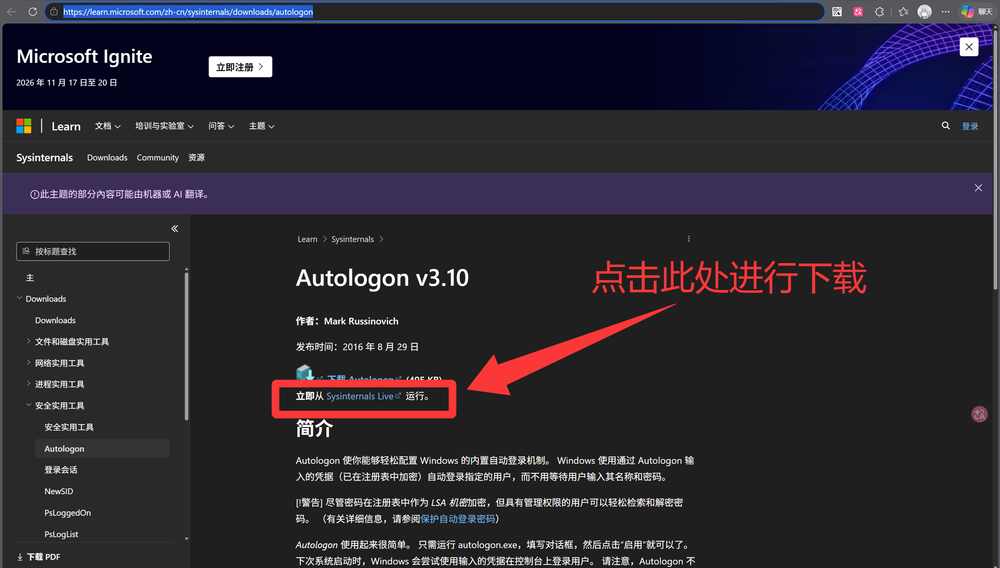

2. 下载完成后，双击运行 `Autologon.exe`。

   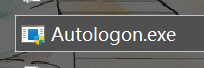

3. 在第三行 **Password** 中输入你的密码。第一、第二行一般会自动读取你的账户名与设备名，不用手动填写。

   是本地账户就输本地账户的密码，是微软账户就输微软账户的密码。

   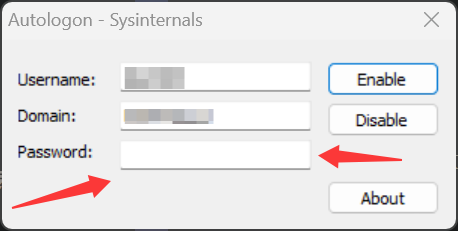

4. 点击 **Enable**。

   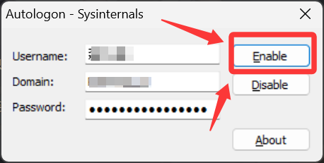

5. 实际测试。

   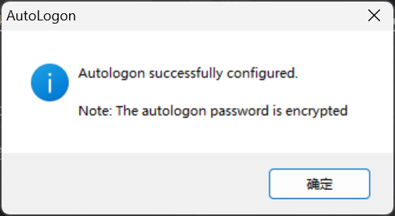

   若出现上方所示的弹窗，即表示设置成功，重启电脑试试看吧。

<details>

<summary>坏结局</summary>

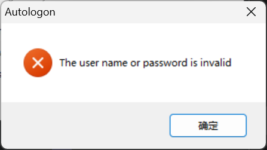

密码输入错误。如果你尝试的是微软账户的密码，那就换成输入本地账户密码，反之亦然。

</details>

<details>

<summary>如何关闭/禁用 Autologon</summary>

1. 打开 `Autologon.exe`，点击 **Disable** 即可。

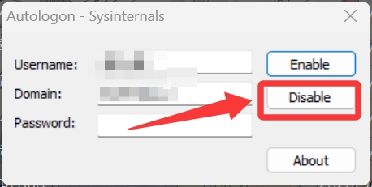

</details>

</details>

### 方法 2：Windows 自带设置，无需额外下载软件

<details>

<summary>使用 Windows 自带系统设置，无需额外下载软件</summary>

1. 打开系统设置（`Win + I`）。

2. 点击进入 **账户 → 登录选项**。

   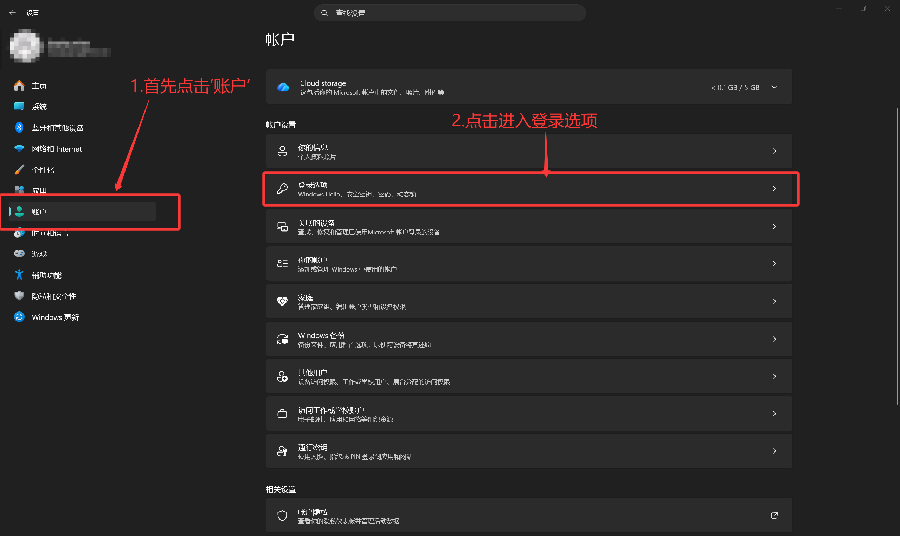

3. 关闭 **其他设置** 中的图示选项。

   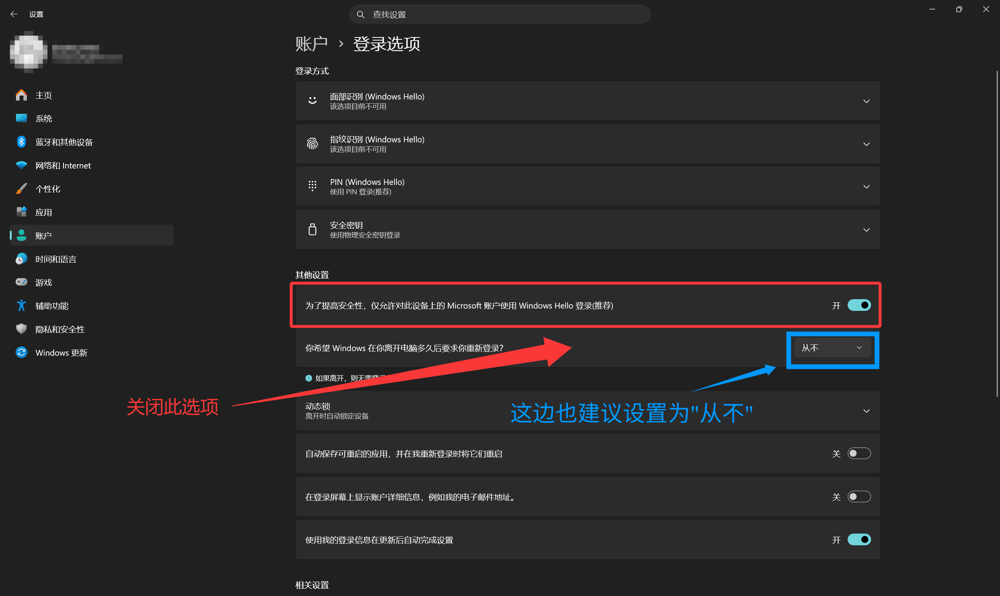

4. 按 `Win + R` 打开「运行」对话框，输入 `netplwiz` 回车，打开「用户账户」窗口。

```cmd
netplwiz
```

5. 取消勾选“要使用本计算机，用户必须输入用户名和密码(E)”。

   - 取消勾选后，依次点击 **应用 → 确定**。

   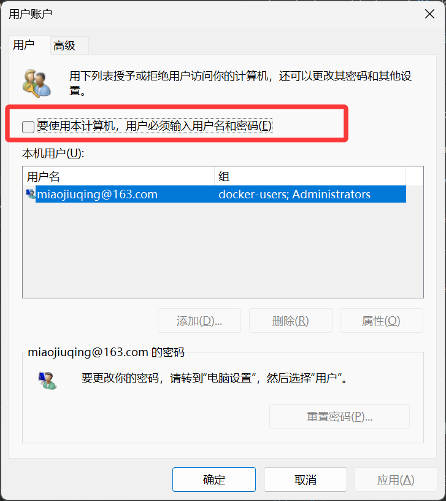

6. 重启电脑测试是否生效。

7. 如何关闭/禁用

   按相反步骤还原即可：先运行 `netplwiz` 重新勾选“要使用本计算机，用户必须输入用户名和密码(E)”，再到系统设置中重新开启“为了提高安全性，仅允许对此设备上的 Microsoft 账户使用 Windows Hello 登录（推荐）”。

</details>

### 方法 3：创建无密码的本地账户使用

<details>

<summary>将在线账户更改为无密码的本地账户</summary>

1. 打开 **设置 → 账户 → 账户信息（或「你的信息」）**。

   - 点击「改用本地账户登录」，点击 **下一页**，然后输入密码验证身份。

   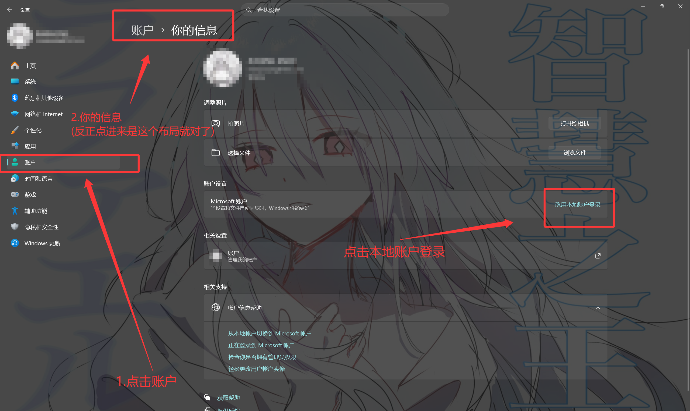

2. 设置本地账户的账户名。

   <p style="color: red; font-size: 3em;"><b>⚠ 密码留空！！！</b></p>

   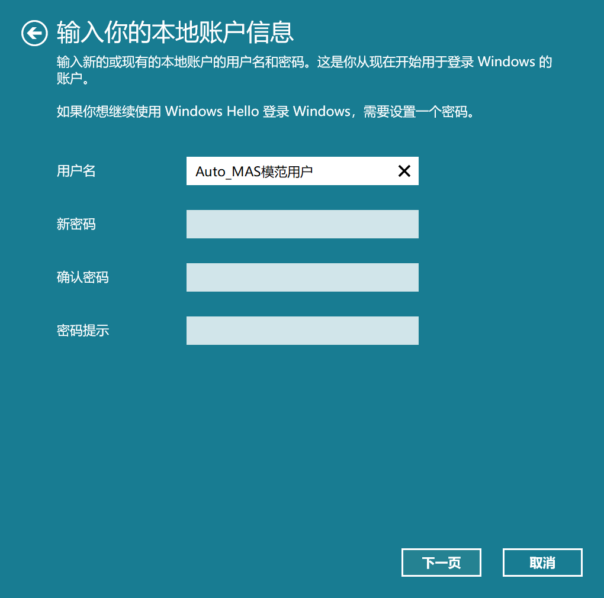

3. 依次点击 **下一页 → 注销并完成**。
   - 这里的“注销”只是结束当前登录会话，相当于退出当前微软账户会话并用本地账户重新登录，不会删除你的文件。

4. 等待注销完成后，重启电脑即可。

5. 如何关闭/禁用

   - 在 **设置 → 账户 → 账户信息** 中重新登录 Microsoft 在线账户即可（原参考视频未具体演示）。

</details>

## macOS：跳过密码输入

待补充...

## Linux：跳过密码输入

待补充...
