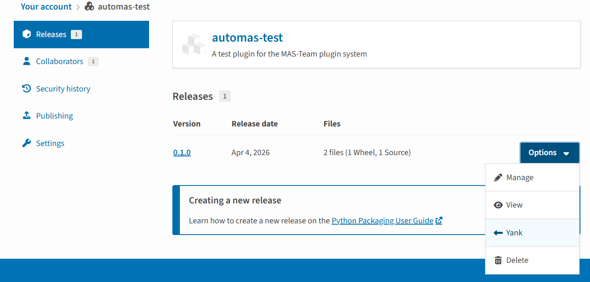

# Publishing Plugins

::: warning
The plugin system is changing fast. This page follows the `dev` branch implementation as of 2026-11-18.
:::

This page shows how to publish a finished plugin to PyPI and get it into the AUTO-MAS plugin marketplace. The path: you publish the package to PyPI, the data site scans PyPI on a schedule to generate the plugin catalog, and the client reads that catalog.

It continues the example from [Plugin Development](./develop.md): distribution `auto-mas-hello-demo`, plugin ID `hello_demo`.

## Pre-publish Checklist

Confirm each item before publishing:

1. `keywords` contains `auto-mas-plugin` and exactly one `auto-mas-id:<plugin ID>`.
2. `dependencies` contains `auto-mas-core`. The data site does not check it when indexing, but the client validates it on install, and a missing one reports "plugin distribution does not declare a valid SDK dependency".
3. The README starts with a complete `auto-mas:i18n` declaration; see the next section.
4. For the data site to discover a new package automatically, the package name contains `auto-mas` or `automas`; see [When the Data Site Catalog Picks You Up](#when-the-data-site-catalog-picks-you-up).
5. `version` is higher than the published ones, in PEP 440 format.

## Marketplace Declaration in the README

The name, description, and tags shown in the marketplace are all written in the first HTML comment of the README. `pyproject.toml` must have `readme = "README.md"`. This README goes into the distribution metadata, and PyPI's JSON API returns it unchanged.

```markdown
<!-- auto-mas:i18n
{
  "display_name_i18n": {
    "zh_CN": "你好示例",
    "en": "Hello Demo",
    "ja": "ハロー・デモ"
  },
  "description_i18n": {
    "zh_CN": "最小插件示例",
    "en": "Minimal plugin example",
    "ja": "最小のプラグイン例"
  },
  "tags_i18n": {
    "zh_CN": ["示例"],
    "en": ["Example"],
    "ja": ["サンプル"]
  }
}
-->

# Hello Demo
```

All three fields are required:

| Field | Content |
| --- | --- |
| `display_name_i18n` | Map from language to name, with at least one non-empty entry |
| `description_i18n` | Map from language to description, with at least one non-empty entry |
| `tags_i18n` | Map from language to a tag array, with at least one language; every array item is a string |

Rules:

- The comment must be the first block of the README, preceded only by whitespace.
- The comment content must be valid JSON.
- Language keys are `zh_CN`, `en`, and `ja`. At display time the user's language is used, falling back to another language if missing. The host only requires at least one language per field; the CI of the official adapter repositories requires all three of `zh_CN`, `en`, and `ja`, and you should do the same.
- Put a plain description in `project.description`, and only real HTTP/HTTPS links in `project.urls`. The documentation, homepage, and source repository addresses are taken from the labels `Documentation`/`Docs`, `Homepage`/`Home`, and `Repository`/`Source`/`Source Code`/`GitHub` respectively.

When the declaration is missing, not at the start, invalid JSON, or any of the three fields fails:

| Where | Consequence |
| --- | --- |
| Data site catalog | The package is not indexed |
| Client falling back to PyPI | The entry does not appear in the marketplace |
| Local source and installed plugins | They work as usual, but the plugin ID is used as the name, `description` as the description, and no tags are shown |

::: warning Breaking the declaration of an already-indexed plugin
If a new version of an already-indexed package loses its keywords or has an invalid declaration, that whole data site refresh round aborts and the old catalog is kept. The new version does not appear, and updates for other plugins are held up too, until someone fixes it. Check before you publish.
:::

## Show Release Notes in the Plugin Market

Keep `CHANGELOG.md` at the root of your plugin repository. Give each release a level-two heading with its PyPI version in brackets.

```markdown
## [1.2.0] - 2026-11-19

- Allow each account to use a different device.
```

Add the public HTTPS link to the file under `[project.urls]` in `pyproject.toml`. Replace the repository and branch in this example with your own.

```toml
[project.urls]
Changelog = "https://github.com/OWNER/REPO/blob/main/CHANGELOG.md"
```

After publishing a new release, open **Changelog** on its PyPI project page and check the file and version heading. The plugin index workflow reads the file, collects notes from the five most recent published versions up to and including the market version, and publishes the catalog to the data site. It skips `Unreleased` and versions you have yet to publish to PyPI.

Once the workflow finishes, download the [public plugin catalog](https://data.auto-mas.top/api/v1/files/auto-mas/Client/plugins/download). Find your package by `package_name` and check its `version` and `changelog`. After refreshing the market, users can expand **Release notes** in **Updates** to see changes since their installed version. The installed plugin's details show the notes for that version. When the app retrieves plugins directly from PyPI or a mirror, it displays no release notes.

## Building the Source

First install the build tool and twine. You can install them in a virtual environment or system-wide; a virtual environment is recommended.

```bash
pip install build twine
```

Go to the plugin project root, for example:

```text
AUTO-MAS/plugins/hello_demo
```

Run:

```bash
python -m build
```

It produces:

```text
dist/
 ├── auto_mas_hello_demo-0.1.0.tar.gz
 └── auto_mas_hello_demo-0.1.0-py3-none-any.whl
```

`uv build` works the same way. After building, check the package metadata:

```bash
twine check --strict dist/*
```

## Registering Accounts

Register PyPI and TestPyPI accounts:

- **Production:** register at [pypi.org](https://pypi.org/).
- **Testing:** register at [test.pypi.org](https://test.pypi.org/). This is a separate test server for validating your release flow; it does not affect the real PyPI.

::: warning
The data site only scans [pypi.org](https://pypi.org/). Packages published to TestPyPI are not indexed into the plugin marketplace.
:::

## Publishing the Plugin

### Manual Upload

Go back to the plugin directory and upload:

```bash
twine upload dist/*
```

To use TestPyPI:

```bash
twine upload --repository testpypi dist/*
```

Manual upload needs a PyPI API token; keep it safe.

### Recommended: Trusted Publishing

We recommend GitHub Actions with PyPI Trusted Publishing: CI proves its identity to PyPI over OIDC, so no token is stored in the repository. The official MAA and Whimbox adapters publish this way; for the full steps see the [MAA adapter publishing guide](https://github.com/AUTO-MAS-Project/AUTO-MAS-MAA-Adapter/blob/master/docs/PUBLISHING.md). The key points:

1. On the **Publishing** page of your PyPI account, add a pending publisher. The PyPI project is only created when the first release succeeds; a pending publisher does not reserve the package name.
   - PyPI project name: your distribution name, such as `auto-mas-hello-demo`
   - Owner / Repository name: the GitHub repository owner and name
   - Workflow name: the workflow file name, such as `publish.yml`, not the workflow's display name
   - Environment name: `pypi`
2. In the GitHub repository, go to Settings → Environments and create an environment named `pypi`. You can require maintainer approval.
3. Grant `id-token: write` only to the publish job. Branch pushes and PRs only build and validate; only `v*` tags upload.
4. The tag must match the version in `pyproject.toml`: version `0.1.0` gets tag `v0.1.0`.

A minimal `.github/workflows/publish.yml`:

```yaml
name: 构建并发布 PyPI 包

on:
  push:
    tags: ["v*"]

permissions:
  contents: read

jobs:
  build:
    runs-on: ubuntu-latest
    steps:
      - uses: actions/checkout@v4
      - uses: actions/setup-python@v5
        with:
          python-version: "3.12"
      - name: 检查标签与包版本一致
        env:
          RELEASE_TAG: ${{ github.ref_name }}
        run: |
          python - <<'PY'
          import os
          import tomllib
          from pathlib import Path

          version = tomllib.loads(Path("pyproject.toml").read_text(encoding="utf-8"))["project"]["version"]
          if os.environ["RELEASE_TAG"] != f"v{version}":
              raise SystemExit("发布标签必须与 pyproject.toml 的版本一致")
          PY
      - run: python -m pip install build twine
      - run: python -m build
      - run: python -m twine check --strict dist/*
      - uses: actions/upload-artifact@v4
        with:
          name: python-distributions
          path: dist/*
          if-no-files-found: error

  publish:
    needs: build
    runs-on: ubuntu-latest
    environment:
      name: pypi
    permissions:
      id-token: write
    steps:
      - uses: actions/download-artifact@v4
        with:
          name: python-distributions
          path: dist/
      - uses: pypa/gh-action-pypi-publish@release/v1
```

The release commands:

```bash
git tag v0.1.0
git push origin v0.1.0
```

The official adapters' workflows also validate the project links and the `auto-mas:i18n` declaration inside the wheel after building; see the [Whimbox adapter's publish.yml](https://github.com/AUTO-MAS-Project/AUTO-MAS-Whimbox-Adapter/blob/master/.github/workflows/publish.yml) for reference.

::: tip
When installing from the marketplace, the host supplies its own bundled `auto-mas-core` to the dependency resolver. You do **not** need to publish the SDK to PyPI first, and you should not remove it from your `dependencies`. You only need to provide a compatible SDK separately if a user bypasses the Plugin Center and runs `pip install` on your package directly.
:::

## Updating the Plugin Version

The version is in `pyproject.toml`:

```toml
version = "0.1.0"
```

After changing the plugin, raise it by hand and publish again, in PEP 440 format, for example `0.1.1`.

::: tip Reminder
PyPI requires a new version number for every release, so whenever you update the code you must raise the version. The client also relies on the version number to tell whether an upgrade is available.
:::

## Acceptance

After publishing, confirm the three steps below in order. If a step fails, do not move on to the next.

### 1. Published on PyPI

Confirm PyPI has the new version and that the metadata the data site reads is correct. The data site reads PyPI's JSON API, and you can look at it directly:

```powershell
$info = (Invoke-RestMethod https://pypi.org/pypi/auto-mas-hello-demo/json).info
$info.version
$info.keywords
$info.description.Substring(0, 40)
```

You should see the new version, `keywords` containing `auto-mas-plugin, auto-mas-id:hello_demo`, and `description` starting with `<!-- auto-mas:i18n`.

### 2. Indexed in the data site catalog

Open the catalog the client uses and look for your package under `plugins`:

```powershell
(Invoke-RestMethod https://data.auto-mas.top/api/v1/files/auto-mas/Client/plugins/download).plugins |
    Where-Object package_name -eq 'auto-mas-hello-demo' |
    Select-Object package_name, plugin_name, version
```

If the version is the one you just published, the data site has updated. If nothing comes back, see the next section.

### 3. Display and install work in the client

1. Use a clean test environment, and do not leave the same plugin's source under `plugins/`. Local source overrides an installed distribution, so it cannot prove the PyPI install works.
2. Open the Plugin Marketplace (「插件市场」). The client refreshes the catalog automatically when you enter the page, or you can click "Refresh" (「刷新」).
3. Find your plugin, check the name, description, tags, and version, and click install. The install may ask you to restart the backend.
4. Go back to the Plugin Center (「插件中心」), check the package name, version, source ("Plugin Marketplace", 「插件市场」), and state, then enable it and confirm it works.

::: tip
If it cannot be installed right after publishing, the mirror used for dependency resolution may not have synced the new version yet. Try again a little later; do not mistake it for a failed release.
:::

## When the Data Site Catalog Picks You Up

The catalog is generated by GitHub Actions in the [AUTO-MAS-Plugin-Index](https://github.com/AUTO-MAS-Project/AUTO-MAS-Plugin-Index) repository. It does not install or run your plugin; it only reads metadata on PyPI.

| Case | Timing |
| --- | --- |
| A new version of an already-indexed plugin | Refreshed every 30 minutes, then you also wait for the catalog to be uploaded to the data site and made public |
| A brand-new package | PyPI is scanned for new candidates once a day at 00:07 UTC (08:07 Beijing time). GitHub scheduled jobs can be delayed, and a maintainer can also run `discover` manually for an immediate scan |

Whether a new package can be discovered depends on its name:

- Automatic discovery is a name heuristic: the package name (case-insensitive, with `-`, `_`, and `.` treated as the same) must contain `auto-mas` or `automas`.
- A package whose name has neither can only be added by a maintainer to `config/packages.json` in that repository. Contact a maintainer if you need that.
- Being added or auto-discovered only makes it a candidate. Whether it is finally indexed still depends on the two keywords in the distribution metadata and a complete `auto-mas:i18n` declaration. The `auto_mas_core` that ships with the main program does not enter the marketplace catalog.

For a package that is already indexed or manually added, a read failure or an invalid declaration aborts that refresh round and the old catalog stays available. An unknown candidate that is not yet indexed with a bad declaration is simply skipped. An indexed package that is not on the manual list is only removed when PyPI explicitly returns 404; a 404 for a package on the manual list also aborts the round.

### Client Refresh Behavior

The client refreshes the catalog automatically when it enters the marketplace page, and also when you click "Refresh". Each refresh reads the data site catalog first (5-second timeout). When it succeeds, the result directly replaces the local marketplace catalog, and **no further lookup on PyPI is made for new packages that were not indexed**. Only when the data site catalog is unavailable (network failure, timeout, content validation failure) does it fall back to per-package search on PyPI and mirrors.

So if a package is already on PyPI but not yet in the data site catalog, you will not see it in the marketplace. Wait for the indexing timing above, or contact a maintainer to add it.

::: tip Self-testing a new package that is not indexed yet
Before starting the backend, set the environment variable `AUTO_MAS_PLUGIN_INDEX_URL` to an unusable HTTPS address (for example `https://127.0.0.1:9/`). The data site catalog read then fails, and the client falls back to PyPI search. The fallback search also finds new packages by name, so the package name must contain `auto-mas` or `automas`. This is for developer self-testing only and affects only your own backend.
:::

## Yanking a Release

If you uploaded a plugin to PyPI and later find it may cause errors or a serious vulnerability, you can mark it as yanked:

1. Log in to PyPI
2. Go to your project page
3. Click **"Manage"**
4. Go to **"Releases"**
5. Find the version you want to withdraw
6. Click **"Options"** next to that version
7. Choose Yank



::: tip What is it for?

Yanked means a withdrawn release:

- It applies to **one version** (not the whole package)
- It means this version is **not recommended** for installation (for example, it has a serious bug)
- `pip install`:
  - does not select a yanked version by default
  - but still installs it if you **specify the version explicitly**

Yanking prevents accidental installs when no version is specified.

:::

::: warning Can I delete the whole package or a version?

- You can delete:
  - a single release (version)
  - or the entire package
- But:
  - it is **irreversible**
  - it breaks dependency chains (so it is generally not recommended)

PyPI itself encourages **marking as deprecated rather than deleting**.

Unless you are dealing with a serious supply-chain attack or malicious code, deleting is generally not recommended.

:::
