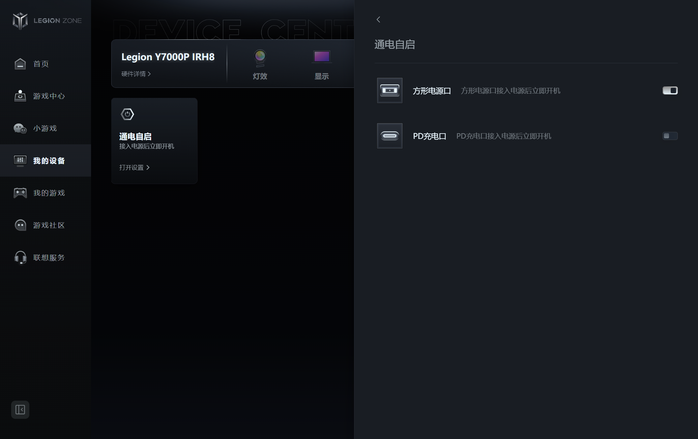
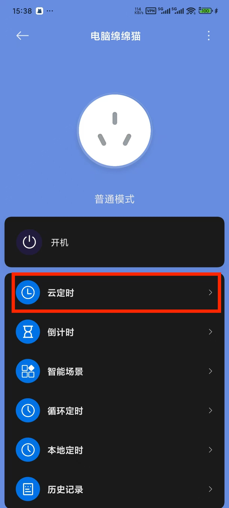

<!-- markdownlint-disable MD033 MD007 MD029 MD060 -->

# Scheduled Computer Startup

## Windows: Scheduled Startup

### Method 1: BIOS RTC Wake-Up

Configure RTC scheduled power-on in BIOS

- **Pros**: Not affected by smart-plug setup or external accessories
- **Cons**: A laptop will power on even when unplugged

1. Enter BIOS setup.

   - The shortcut key varies by brand and model—commonly `Delete` or `F2` pressed repeatedly right after powering on (`F12` usually opens the boot device menu rather than BIOS). Check your motherboard or laptop manual if unsure.

2. In BIOS, open the **SETTINGS** menu.

3. Find **Wake Up Event Setup**. The exact menu name differs widely across motherboard brands; common alternatives include `Resume by RTC Alarm` and `Power On By RTC`.

   - RTC (Real-Time Clock) is an independent clock chip on the motherboard that keeps running even while the computer is turned off. When the scheduled time arrives, the RTC signals the motherboard to power on the system.
   - Set **Resume by RTC Alarm** to **Enable**.

4. Set **Date (of Month) Alarm** to `0`.

   | Value | Meaning |
   | --- | --- |
   | `1-31` | Trigger on day 1–31 of each month |
   | `0` or `*` | Trigger every day (ignore date) |
   | Specific day (e.g., `15`) | Trigger on the 15th of each month |

   - **Date (of Month) Alarm** selects which day of the month the RTC alarm fires. On most motherboards, `0` means every day (some firmware uses `0` to disable it—check the on-screen help in your BIOS).
   - The `Time(hh)`, `Time(mm)`, and `Time(ss)` fields set the automatic power-on time.
   - For example, to power on every day at 03:45:

     - `Time(hh) Alarm`: `3`
     - `Time(mm) Alarm`: `45`
     - `Time(ss) Alarm`: `0`

5. Press `F10` to save and exit BIOS, then reboot into Windows.

### Method 2: Power-On via a Smart Plug (AC Power Loss Recovery)

Trigger automatic startup by cycling power with a smart plug

*(Not sponsored: the example below uses a Xiaomi Mi Home smart plug controlled through the Mi Home app. Screenshots show the Chinese interface.)*

- **Pros**: Easily adjust schedules from your phone without entering BIOS
- **Cons**: Requires buying a remotely controllable smart plug
- Only works on devices that support **Restore on AC Power Loss** (automatically powering on when AC power returns)

1. Plug your computer's power cable or power adapter into the smart plug, and pair the smart plug with its companion app according to the manufacturer's instructions.

2. Enable **Restore on AC Power Loss** (power-on after power restored) on your computer.
   - The screenshot below shows an example on a Lenovo device; look for the equivalent BIOS or vendor utility option on your own machine.

   

3. In the smart plug app (Mi Home in this example), schedule the plug to **turn off, then turn back on**, with at least 1 minute between the two events.

   - When you shut down normally while staying plugged in, the motherboard remains on standby power, so simply sending a "turn on" command will not trigger AC power recovery. The cycle works like this:

   | Time | Smart plug | Computer state |
   | --- | --- | --- |
   | Normally | Power on | Shut down with standby power |
   | At power-off time | Power off | Shut down, completely unpowered |
   | At power-on time | Power restored | Motherboard detects power return → boots automatically |

   - Set the **power-on** time to whenever you want the computer to boot. Do not make the off interval too short, or the motherboard may not detect the power loss and fail to auto-start.
   - Example:

     

       
       
     

4. Test it: shut down Windows normally, wait about a minute until the PC is completely off, turn the smart plug off in the app, wait another minute, and turn it back on. If the PC powers up on its own, everything is working.

## macOS: Scheduled Startup

To be added...

## Linux: Scheduled Startup

To be added...

The methods above were compiled from community resources. Please report any errors or omissions.

References

- Contact the page author if any reference needs to be removed.

[肘击王结城友奈](<https://www.bilibili.com/video/BV1pKwxzwEaP?vd_source=43fdeaf65ea5c12a419d74d955a2ebfd>)

[IT豪哥](<https://www.bilibili.com/video/BV1QY411q7cT?vd_source=43fdeaf65ea5c12a419d74d955a2ebfd>)

[Qwen](<https://www.qianwen.com/>) and [DeepSeek](<https://www.deepseek.com/>) were also consulted on risk notes and formatting during drafting.

