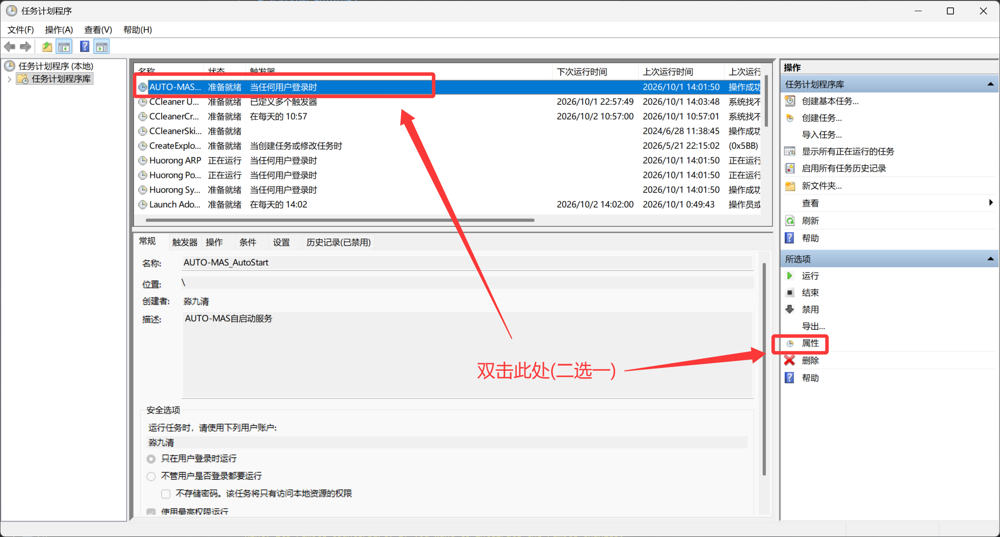
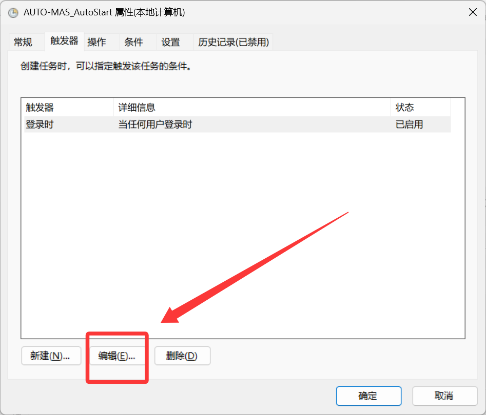
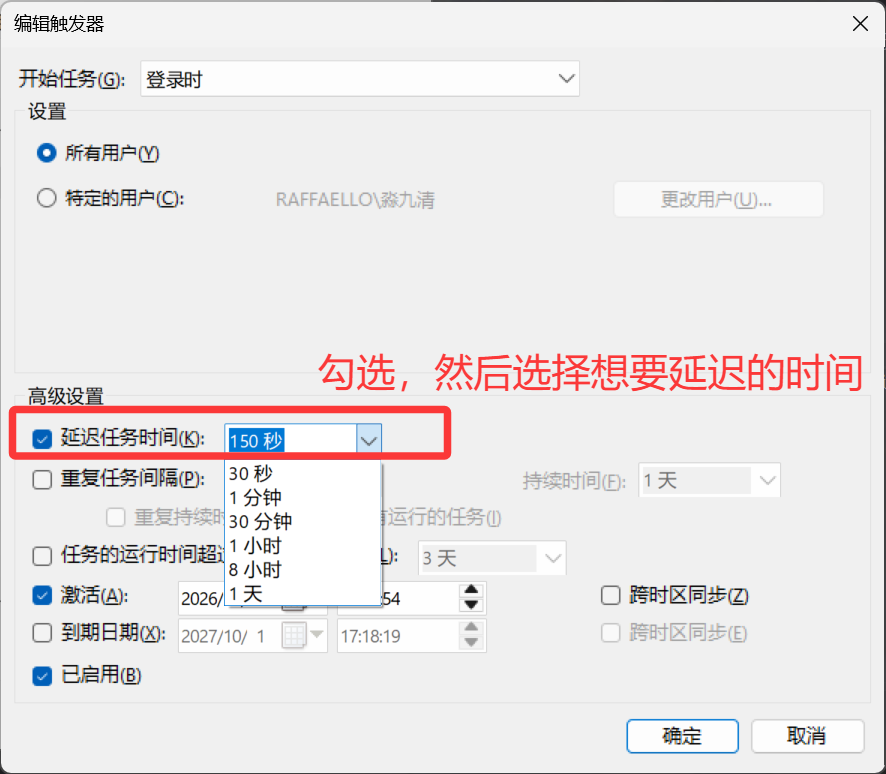

<!-- markdownlint-disable MD033 MD007 MD029 MD060 MD046 -->

# Scheduled and Delayed App Startup

> This guide currently covers Windows only.

This page explains how to control **when the AUTO-MAS application itself launches**, covering two common scenarios:

- **AUTO-MAS launches on boot before the network is ready and fails with "Runtime environment failed (`RUNTIME_PIN_UNAVAILABLE`)", working only after a manual retry** → see **Delayed Startup** below to wait a short while after login before launching.
- **You want AUTO-MAS to launch automatically at a fixed time every day** (on a PC that stays powered on) → see **Scheduled Startup** below.

> Windows Task Scheduler cannot wake a completely shut-down computer. To power on your PC automatically from a full shutdown, see [Scheduled Computer Startup](./Timed-Startup).

---

## 1. Delayed Startup (Wait N Seconds After Login)

### How It Works

When you enable auto-start on boot in AUTO-MAS, it registers a Windows scheduled task named `AUTO-MAS_AutoStart` that **launches immediately upon login**. If your network or DNS is not ready yet, fetching mirror or Runtime metadata may fail (for example with `getaddrinfo ENOTFOUND`).

Adding a **Delay** to the logon trigger reduces startup failures caused by an unready network. A delay only helps when retrying after the network comes up succeeds; if `RUNTIME_PIN_UNAVAILABLE` persists, check the [FAQ](../FAQ) for detailed troubleshooting.

### Method 1: Graphical Interface (Preset Intervals Only)

> Note: The screenshots below show the Chinese Windows Task Scheduler interface.

1. Press `Win + R`, enter `taskschd.msc`, and press Enter (or search for **Task Scheduler** in the Start menu).
2. Find **`AUTO-MAS_AutoStart`** in the task list and double-click it to open its properties.
   - If `AUTO-MAS_AutoStart` does not exist, enable auto-start on boot inside AUTO-MAS first.
   
3. Switch to the **Triggers** tab, select the **At log on** trigger, and click **Edit**.
   
4. Check **Delay task for** and pick a preset duration from the dropdown (only presets such as 15 seconds, 30 seconds, 1 minute, or 5 minutes are available—custom values like 2 minutes 30 seconds are not listed).
   
5. Click **OK** in the lower-right corner to save.

### Method 2: Command Line (Administrator, Any Custom Duration)

If the preset options are not flexible enough, set any custom delay from an elevated terminal using the format `mmmm:ss` (4-digit minutes : 2-digit seconds).

For example, to wait 2 minutes and 30 seconds after login before starting AUTO-MAS:

```bat
:: Run in an Administrator terminal
schtasks /Change /TN "AUTO-MAS_AutoStart" /DELAY 0002:30
```

| Desired delay | Value to enter |
| --- | --- |
| 30 seconds | `0000:30` |
| 1 minute | `0001:00` |
| 2 minutes 30 seconds | `0002:30` |
| Remove delay (start immediately at login) | `0000:00` |

When it succeeds, you will see output like this:

```bat
C:\Users\Username> schtasks /Change /TN "AUTO-MAS_AutoStart" /DELAY 0002:30
SUCCESS: The parameters of scheduled task "AUTO-MAS_AutoStart" have been changed.
```

::: warning Important Notes

- You must run the command in an **Administrator terminal** (right-click the Start button → **Terminal (Admin)**). Running it in a normal terminal produces an "Access is denied" error.
- If prompted for a password for your user account, enter your **Windows account password** (not your PIN).
- You can verify the saved setting with the command below—seeing `<Delay>PT2M30S</Delay>` confirms it was applied:

```bat
schtasks /Query /TN "AUTO-MAS_AutoStart" /XML
```

- When you reopen the trigger in the Task Scheduler GUI, the dropdown may appear blank or show a default value because it cannot display custom durations. **This is normal—trust the value reported by the command line.**
:::

---

## 2. Scheduled Startup (Launch at a Fixed Time Daily)

If your PC stays powered on and you want AUTO-MAS to launch automatically at a specific time (for example, 03:45 every morning), create a new scheduled task.

### Method 1: Graphical Interface

1. Open `taskschd.msc` and click **Create Task** in the right-hand Actions pane (not "Create Basic Task").
2. **General** tab: set the name to `AUTO-MAS_TimedStart` and check **Run with highest privileges**.
3. **Triggers** tab → **New** → begin the task **On a schedule** → select **Daily** → set the start time (for example, `03:45`).
4. **Actions** tab → **New** → set **Program/script** to your `AUTO-MAS.exe` path (for example, `D:\aWa\AUTO-MAS\AUTO-MAS.exe`), and set **Add arguments** to `--auto-start`.
5. **Conditions** tab: if you want Windows to wake from sleep to run the task, check **Wake the computer to run this task**.
6. Click **OK** to save.

### Method 2: Command Line (Administrator)

```bat
:: Launch AUTO-MAS daily at 03:45 with highest privileges (replace the path with your actual install location; /F overwrites an existing task with the same name)
schtasks /Create /TN "AUTO-MAS_TimedStart" /TR "\"D:\aWa\AUTO-MAS\AUTO-MAS.exe\" --auto-start" /SC DAILY /ST 03:45 /RL HIGHEST /F
```

To change the schedule or delete the task:

```bat
:: Change the time to 05:00 daily
schtasks /Change /TN "AUTO-MAS_TimedStart" /ST 05:00

:: Delete the task
schtasks /Delete /TN "AUTO-MAS_TimedStart" /F
```

::: tip Good to Know

- **A completely shut-down PC cannot be woken by Task Scheduler**: scheduled tasks only trigger when the computer is powered on, asleep, or hibernating. To power on from full shutdown, configure BIOS RTC wake-up in [Scheduled Computer Startup](./Timed-Startup).
- **AUTO-MAS already includes built-in scheduled queues**: if AUTO-MAS stays running and you only want scripts to run at fixed times each day, you do not need a Windows scheduled task—use the built-in **Scheduled Run** option in the queue settings (see [Task Management](../task-scheduler)).
- **Delayed startup and daily scheduled startup can be used together**: login delay avoids network-not-ready errors on boot, while the daily task launches AUTO-MAS on schedule without conflicting with each other.
:::
