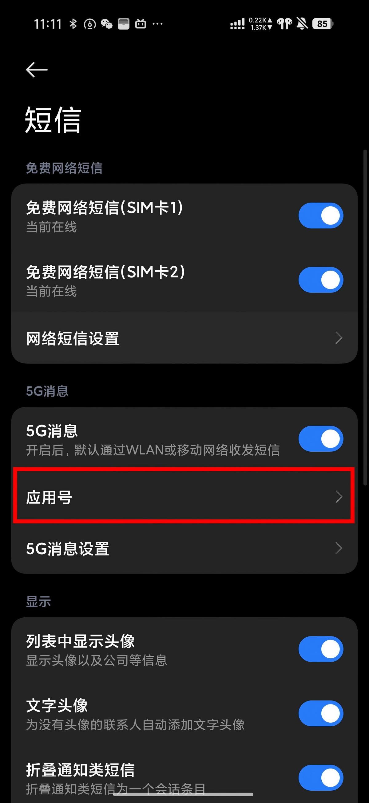
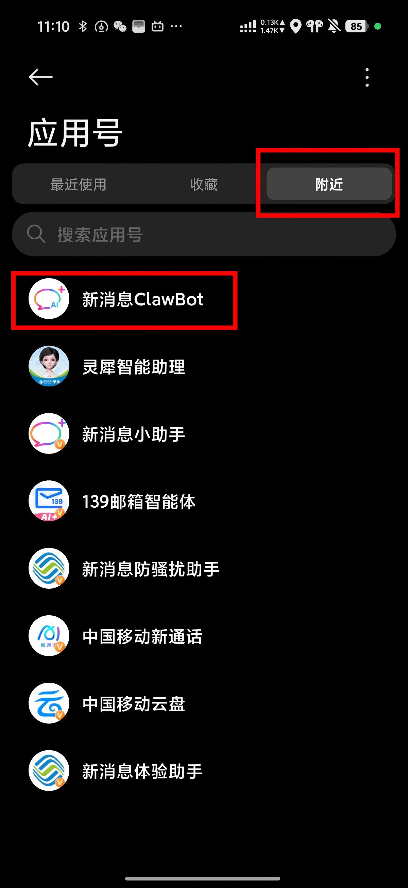
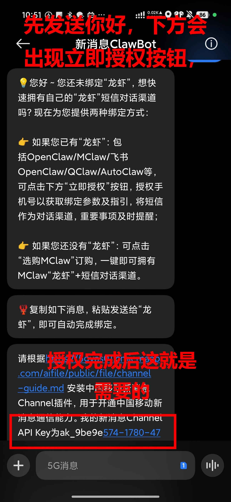

# Notifications

Get told when a run finishes or an account fails. Choose a channel in notification settings, including email, ServerChan, a WeCom group bot, or China Mobile 5G SMS.

## Two Levels: Global and Per-Account

::: info Example version and scope
This section uses **AUTO-MAS v5.8.0-beta.3**. The screenshots show the Chinese interface and demonstration data. No external notification was sent.
:::

### Global notifications: open a channel to configure it

Open **Settings > Notifications** (设置 > 通知设置). Channels are shown as cards or list entries. Click a channel such as **Email** (邮件) to open its configuration dialog.

To receive task results, also choose when to send them under **Notification content > Task result timing** (通知内容 > 推送任务结果时机). The **Do not send** (不推送) value shown in the screenshot disables task-result notifications.

For email, enter the SMTP server, sender, recipient, and authorization code, then enable the channel. Changes save immediately. Use **Close** (关闭) in the upper-right corner to return to the list.

Use the test-notification action and check the receiving service. Saving configuration does not prove delivery.

### Per-account notifications: send an additional copy

Open the account under Managed scripts (托管管理), then find **Notification settings** (通知配置). Turn on **Enable notifications** (启用通知) and the required channel. For email, turn on **Email notification** (邮件通知) and enter that account's recipient.

::: tip An account notification adds a copy
Global notifications still use the global settings. Per-account notifications send that account's results separately. An account recipient does not replace the global sender and authorization code; configure global email settings first.
:::

## Email Notifications

To receive notifications by email you need three things: an **SMTP server address**, a **sending address**, and an **authorization code**. Here is how to get each one.

### SMTP Server Address

Find the provider of your sending address and copy the matching row.

| Email service provider | SMTP server address   |
| ---------------------- | --------------------- |
| **QQ Mail**            | smtp.qq.com           |
| **163 Mail**           | smtp.163.com          |
| **Gmail**              | smtp.gmail.com        |
| **Yahoo Mail**         | smtp.mail.yahoo.com   |

If your email service is not listed, search its help center for "SMTP server address".

::: warning Outlook.com / Hotmail sender accounts
Microsoft requires port 587, STARTTLS, and OAuth2 for Outlook.com SMTP. The built-in email channel in the version shown here uses SSL on port 465 with password-based authentication. Entering an Outlook server address and app password is insufficient; use a compatible sender or another notification channel. See [Microsoft's SMTP requirements](https://support.microsoft.com/en-us/outlook/pop-imap-and-smtp-settings-for-outlook-com).
:::

### Get an Authorization Code

**An authorization code is not your mailbox login password.** It is a separate code your provider issues for third-party software, and you have to go and generate it yourself. Getting this wrong is the most common reason email notifications fail.

Providers name it differently: QQ Mail and 163 Mail call it an authorization code, while Gmail and Yahoo call it an **app password**. It is the same thing, and it goes in the same field.

Where each provider hides it:

1. **QQ Mail**

<Pill name="QQ Mail official guide" image="https://res.wx.qq.com/t/webmail/webmail/res/static/images/projects/login/loginpage/qqmail_logo_default_35h.e071fb4.png" link="https://service.mail.qq.com/detail/0/75"/>

- Log in to your [QQ Mail Account and Security Center](https://wx.mail.qq.com/account).
- Go to **Account and Security > Security Settings > SMTP/IMAP Service**, enable the service, and get the authorization code.

2. **163 Mail**

<Pill name="163 Mail official guide" image="https://help.mail.163.com/style/img/logo-163.png" link="https://help.mail.163.com/faqDetail.do?code=d7a5dc8471cd0c0e8b4b8f4f8e49998b374173cfe9171305fa1ce630d7f67ac2a5feb28b66796d3b"/>

- Log in to [163 Mail](https://email.163.com).
- Go to **Settings > POP3/SMTP/IMAP**, find **IMAP/SMTP Service**, and enable it.
- In the popup, click **Continue enabling** and follow the instructions to send an SMS from your phone.
- The popup generates an **authorization password**. That is the code you need.

3. **Gmail**

- Log in to [Gmail](https://mail.google.com).
- Go to **Settings > See all settings > Forwarding and POP/IMAP > IMAP access**, then select **Enable IMAP**.
- Go to **User > Manage your Google Account > Security > 2-Step Verification** and enable **2-Step Verification**.
- Go to **2-Step Verification > App passwords** and create an **app password**. That is the code you need.

4. **Yahoo Mail**

- Log in to your **Yahoo account**.
- Go to the account's **Security settings**.
- Find **Generate app password** or a similar option to create an app password.

::: tip One Mailbox Is Enough
The sending address and the recipient address can be the same. Mailing yourself works fine.
:::

::: warning About the Authorization Code

- Do not share it with anyone, and rotate it now and then.
- Some providers show it **only once**, so save it as soon as you get it. Some expire, and notifications silently stop when they do, so replace it before then.
- It is stored encrypted on your machine, tied to your Windows account. **After changing computers or reinstalling Windows, you have to enter it again.**
:::

## ServerChan (Push to Your Phone)

**ServerChan** is a relay service that forwards messages to your phone. Enter the key it gives you into AUTO-MAS and your run results get pushed to your phone.

<Box :items="[
{ name: 'ServerChan Turbo', link: 'https://sct.ftqq.com/', image: 'https://the7.ft07.com/sct/images/favicon.png' },
{ name: 'ServerChan³', link: 'https://sc3.ft07.com/', image: 'https://the7.ft07.com/sct/images/favicon.png' },
]"/>

::: warning There Are Two Versions, Don't Mix Them Up
ServerChan released a new version in 2024, and the two are separate products:

- **SCT** = ServerChan Turbo, the older version. It supports many channels, including WeChat, DingTalk, and Feishu.
- **SC3** = ServerChan³, the newer version. **It only pushes to its own app.**

AUTO-MAS uses the same configuration entry for both products. Enter the SendKey from the platform you use.
:::

### SendKey (Required)

The SendKey is how ServerChan identifies you, and messages have nowhere to go without it. Get yours from the page for your version. **Pick one platform, not both:**

- SCT users: <Pill name="SCT SendKey" image="https://the7.ft07.com/sct/images/favicon.png" link="https://sct.ftqq.com/sendkey"/>
- SC3 users: <Pill name="SC3 SendKey" image="https://the7.ft07.com/sct/images/favicon.png" link="https://sc3.ft07.com/sendkey"/>

Open **ServerChan** in AUTO-MAS notification settings, enter the SendKey, enable the channel, and send a test notification. Current versions have no channel-code or Tag fields. Configure SCT receiving channels on the ServerChan platform.

## WeCom Group Bot (Push to WeChat)

::: info Set It Up Once, Then Read Messages in WeChat
You do have to register WeCom, but that is a one-time step just to obtain a bot address. After that, messages arrive in your normal WeChat.
:::

1. **Register an enterprise account**: open the <Pill name="WeCom official website" link="https://work.weixin.qq.com/" image="https://open.work.weixin.qq.com/favicon.ico" /> on a computer, follow the instructions, then log in to the WeCom client with the WeChat account you bound.

2. **Create a group and add a bot**: open the group chat, click the **...** menu in the upper-right corner, and select **Add group bot**. Name and avatar are up to you. This works on desktop and mobile alike.

3. **Get the Webhook URL**:

   - Desktop: right-click the bot in the group chat and select **View profile**.
   - Mobile: group chat, **...** menu in the upper-right corner, **Group bot**, then tap the bot.

4. **Enter it in AUTO-MAS**: paste the Webhook URL into **Push WeCom bot notification**. Done.

## China Mobile 5G SMS

### Prerequisites

Before using China Mobile 5G SMS (中国移动新消息), make sure that:

1. Your SIM card uses a China Mobile number.
2. Your phone supports 5G Messaging (RCS / 5G 消息).
3. The 5G Messaging service is activated on your line.

### Step 1: Obtain a Channel API Key

The Channel API Key is the credential used to connect to China Mobile 5G Messaging. You can obtain it using either method below.

#### Method 1: Via the "新消息ClawBot" App Account

**Note: Screenshots are from a Xiaomi phone; menus on other brands may differ slightly.**

1. Confirm that your active SIM card is a China Mobile number.
2. Open your phone's system Messaging settings and go to **App Accounts** (应用号).
   
3. Search for and open **新消息ClawBot**.
   
   If 5G Messaging is not yet activated, follow the on-screen prompts to enable it.
4. Locate and copy the **Channel API Key** inside **新消息ClawBot**.
   

   A valid Channel API Key usually starts with `ak_` or `app_`. Make sure you copy the complete key without extra spaces, line breaks, or surrounding text from the message.

#### Method 2: Via SMS Authorization

1. Using your China Mobile number, send an SMS containing `绑定龙虾` to `12520098`.
2. Wait for the reply SMS.
3. Open the reply SMS and tap **立即授权** (Authorize Now).
4. Follow the on-screen instructions to complete authorization and copy your Channel API Key.

### Step 2: Configure China Mobile 5G SMS

1. Open AUTO-MAS and go to **Settings > Notifications** (设置 > 通知设置).
2. Open the **China Mobile 5G SMS** (中国移动5G短信) channel.
3. Paste the Channel API Key you copied in Step 1 into the input field and enable the channel.
4. Send a test notification and confirm delivery on your phone.

::: tip Configuration Scope
China Mobile 5G SMS currently supports **global notifications only** and has no per-account configuration entry. Whether task results are sent still depends on the global **Task result timing** (推送任务结果时机) setting.
:::

### Security Notes

- The Channel API Key is a sensitive credential. Do not expose it in screenshots, logs, repositories, or public chats.
- Do not add leading or trailing spaces or extra characters when pasting the key.
