<!-- markdownlint-disable MD033 MD007 MD029 MD060 -->
# Automatic Windows Login

> This guide currently covers Windows only. macOS and Linux instructions are planned.

Before setting this up, make sure you have enabled auto-start on boot in AUTO-MAS and configured scheduled runs for your queue.

You are solely responsible for any consequences of disabling login protection (such as a roommate waking up at midnight to use your PC or accidentally deleting your files). Proceed at your own risk.

::: warning Your Password May Be Stored in Plain Text

Autologon writes your login password into the registry key `HKLM\SOFTWARE\Microsoft\Windows NT\CurrentVersion\Winlogon` under `DefaultPassword` **in plain text**. Anyone with access to the computer can read it, and Microsoft recommends using LSA secrets instead.

Only enable automatic login on a private computer where physical access is trusted.

:::

> Note: The screenshots below show the Chinese Windows interface.

## Windows: Skip the Password Prompt

### Method 1: Autologon (Recommended)

<details>
<summary>Using Autologon</summary>

1. Download Autologon:

   - [Open the official Microsoft Sysinternals Autologon page](https://learn.microsoft.com/en-us/sysinternals/downloads/autologon)

   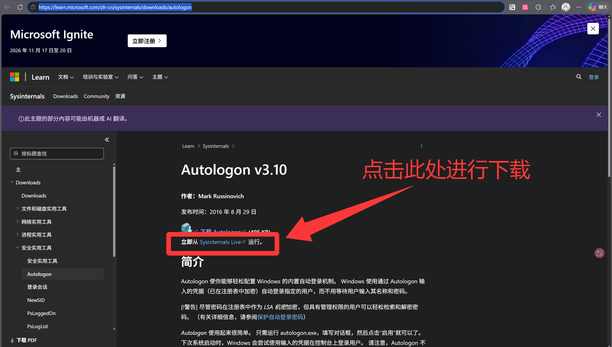

2. After downloading, double-click `Autologon.exe` to run it.

   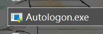

3. Enter your password in the third field (**Password**). The first two fields (username and domain/device name) are usually detected automatically and do not need to be changed.

   Use your local account password if you sign in with a local account, or your Microsoft account password if you sign in with a Microsoft account.

   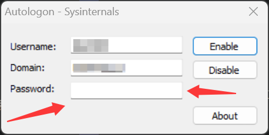

4. Click **Enable**.

   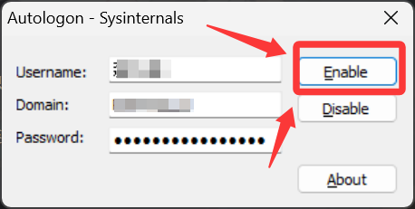

5. Test it.

   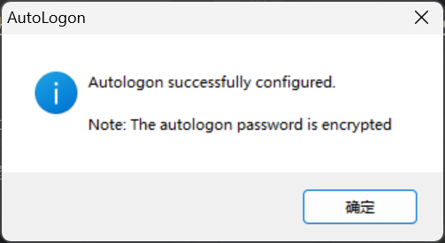

   If you see the confirmation dialog shown above, setup succeeded. Restart your computer to verify.

<details>

<summary>If It Fails</summary>

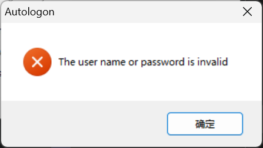

The password was incorrect. If you entered your Microsoft account password, try your local account password instead, or vice versa.

</details>

<details>

<summary>How to Disable Autologon</summary>

1. Open `Autologon.exe` and click **Disable**.

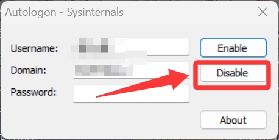

</details>

</details>

### Method 2: Built-in Windows Settings (No Extra Software)

<details>

<summary>Using built-in Windows settings without extra software</summary>

1. Open Windows Settings (`Win + I`).

2. Go to **Accounts → Sign-in options**.

   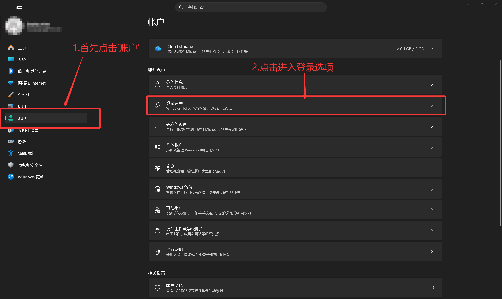

3. Under **Additional settings**, turn off the highlighted option ("For improved security, only allow Windows Hello sign-in for Microsoft accounts on this device (Recommended)").

   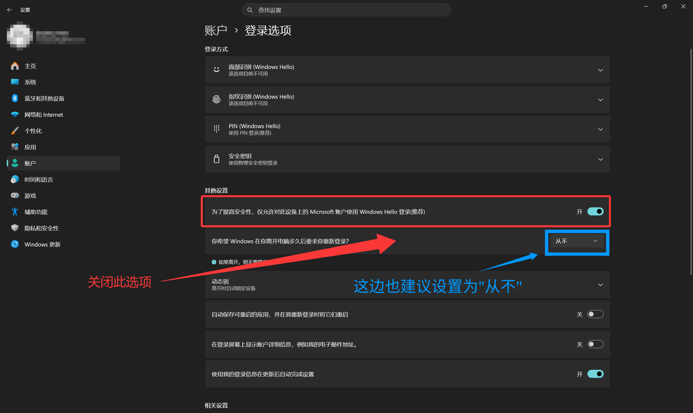

4. Press `Win + R` to open the Run dialog, enter `netplwiz`, and press Enter to open **User Accounts**.

```cmd
netplwiz
```

5. Uncheck **Users must enter a user name and password to use this computer**.

   - Click **Apply**, then **OK**.

   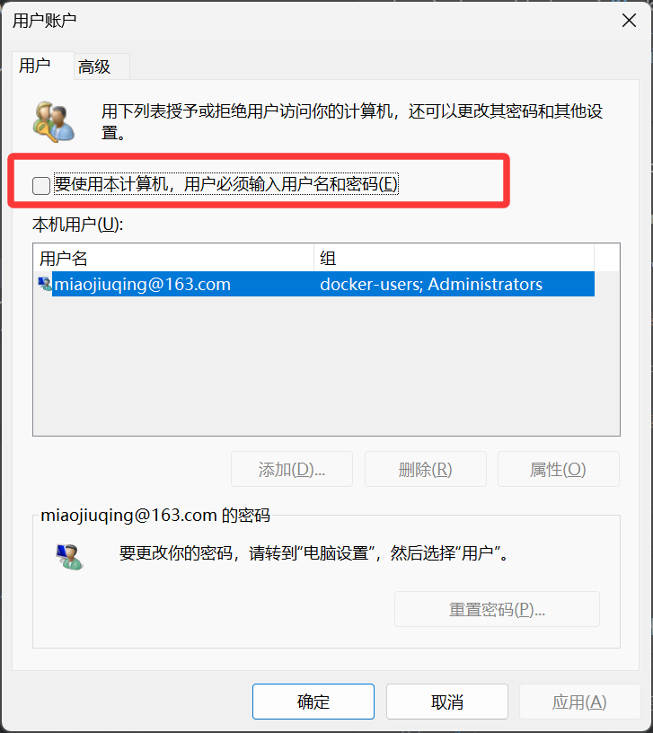

6. Restart your computer to verify.

7. How to revert / disable:

   Reverse the steps above: run `netplwiz` and re-check **Users must enter a user name and password to use this computer**, then re-enable **For improved security, only allow Windows Hello sign-in for Microsoft accounts on this device (Recommended)** in Windows Settings.

</details>

### Method 3: Switch to a Passwordless Local Account

<details>

<summary>Switch an online Microsoft account to a passwordless local account</summary>

1. Open **Settings → Accounts → Your info** (账户信息 / 你的信息).

   - Click **Sign in with a local account instead**, click **Next**, and enter your password to verify your identity.

   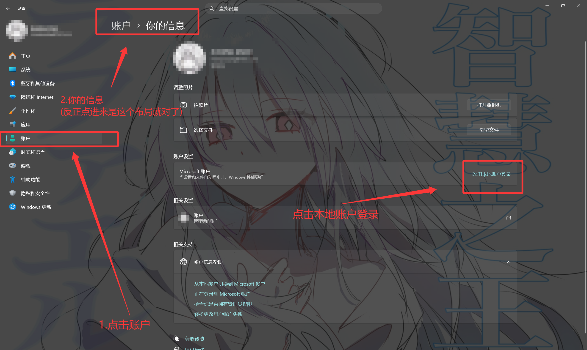

2. Choose a username for the local account.

   <p style="color: red; font-size: 3em;"><b>⚠ Leave the password blank!!!</b></p>

   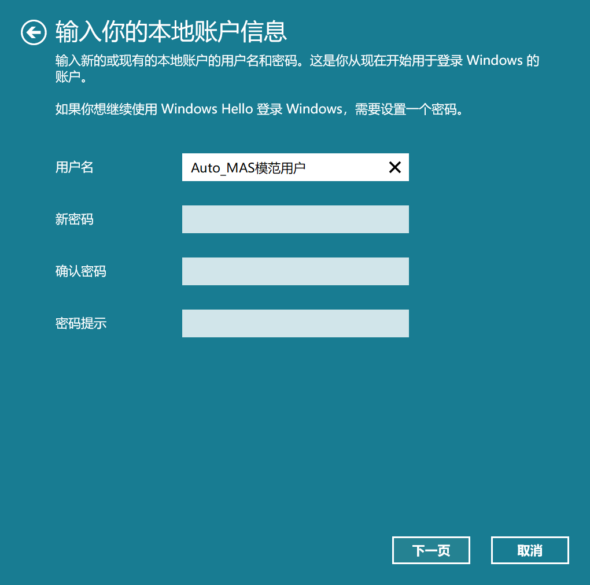

3. Click **Next → Sign out and finish**.
   - "Sign out" here only ends your current Microsoft account session so Windows can sign back in with the local account. It does **not** delete your files.

4. After sign-out finishes, restart your computer.

5. How to revert / disable:

   - Go back to **Settings → Accounts → Your info** and sign in with your Microsoft account again.

</details>

## macOS: Skip the Password Prompt

To be added...

## Linux: Skip the Password Prompt

To be added...
