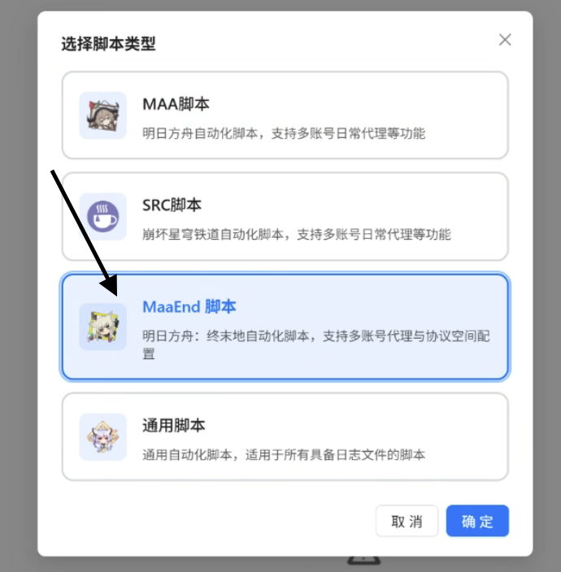
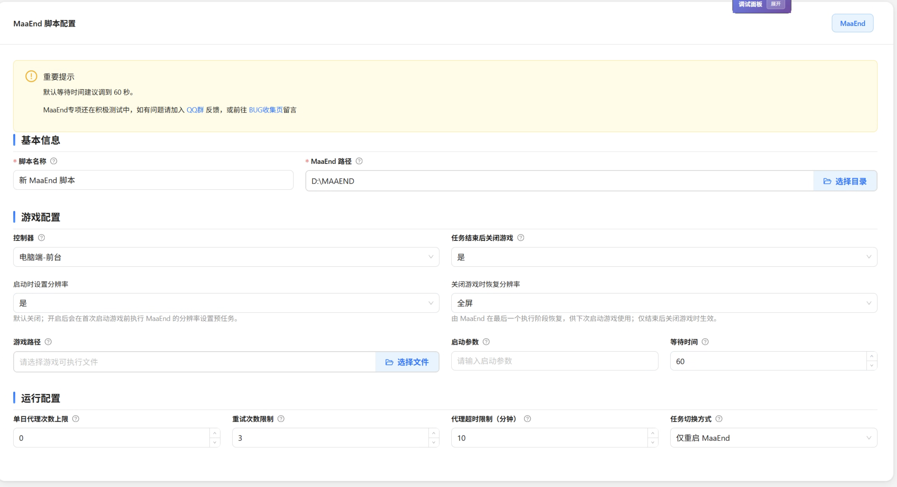
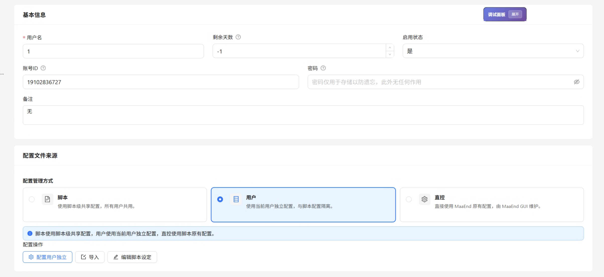
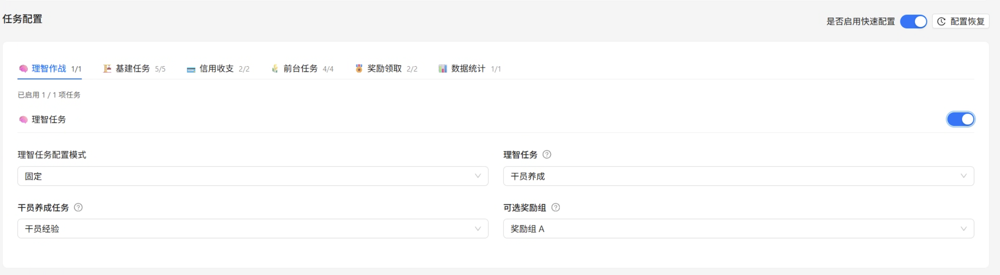
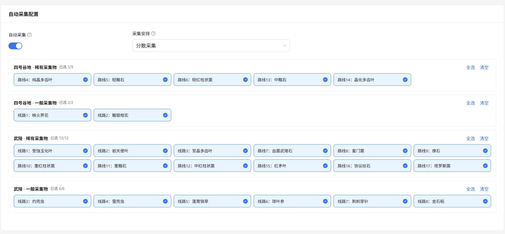
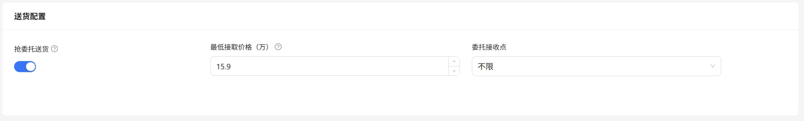
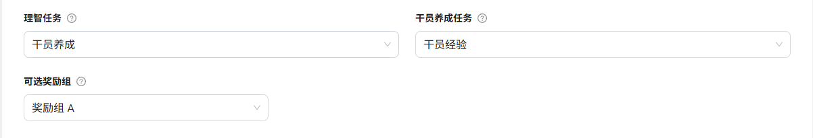

# MaaEnd Configuration Guide

## TL;DR

Download MaaEnd, create and configure a MaaEnd managed script, choose a configuration source, click **Configure MaaEnd** (for non-native configurations) to edit detailed settings, add it to a queue, and start automation!

## What is MaaEnd?

MaaEnd is a third-party automation tool for Arknights: Endfield. Based on visual AI technology, it can automatically complete repetitive daily tasks such as Protocol Space.

**For more information, see:**

<Box :items="[
{ name: 'MaaEnd Website', link: 'https://maaend.com/', image: 'https://maaend.com/favicon.ico', },
{ name: 'MaaEnd GitHub', link: 'https://github.com/MaaEnd/MaaEnd', image: { light: '/icons/github.svg', dark: '/icons/github-dark.svg', }, },]"/>

## Install MaaEnd

1. Download the archive from <Pill name="MaaEnd Website" image="https://maaend.com/favicon.ico" link="https://maaend.com/"/> or <Pill name="MaaEnd Repository" :image="{ light: '/icons/github.svg', dark: '/icons/github-dark.svg', }" link="https://github.com/MaaEnd/MaaEnd/releases/latest"/>.
2. Extract the MaaEnd archive to any folder.

::: warning Two Places Not to Extract It
- **Not into a path with non-ASCII characters in it.** Those paths cause failures that are hard to diagnose. Use a plain English path like `D:\MaaEnd`.
- **Not inside the AUTO-MAS root directory.** Like other scripts, anything in there risks being deleted by accident.
:::

## Configure the Managed Script

::: tip Interface names
Historical screenshots may show “Script Management”, “New Script”, or “User”. These are now “Managed scripts”, “New managed script”, and “Account”; the steps below use the current names.
:::

::: warning Note
The configuration options below apply to **v5.5.0+**. Older versions may differ—refer to what you see in your installed version.
:::

1. Go to **Managed scripts**, click **New managed script**, and select **MaaEnd**.

2. In the opened managed-script settings, click **Select folder** for **MaaEnd path**, then open the directory where MaaEnd is located.

3. Adjust the following configuration as needed:

   | Configuration | What to enter |
   | --- | --- |
   | **Controller type** | PC client or emulator. **The PC client is recommended.** What you pick here overrides the setting inside MaaEnd. |
   | **Game path (PC)** | Pick `Endfield.exe`, **not** the Hypergryph launcher. |
   | **Set resolution on startup (PC)** | When enabled, sets the game resolution to 720p while running MaaEnd to satisfy resolution requirements. |
   | **Restore resolution on finish (PC)** | When enabled, restores the game to your configured resolution (fullscreen or a specified resolution) after all tasks finish. |
   | **Game launch arguments (PC)** | Leave empty unless needed. |
   | **Wait time after game startup (PC)** | No need to fill in; now handled by MaaEnd itself. |
   | **Close game after task completion** | Whether to close the game automatically once an account finishes. |
   | **Proxy timeout limit** | How many minutes without log activity counts as a hang. Default is 10. |
   | **Daily proxy count limit** | Maximum runs per account per day. `0` means unlimited. |
   | **Maximum retry count per run** | How many times to retry after a failure. Default is 3. |
   | **Task switching mode** | MaaEnd runs in three stages (Delivery, Daily, Gathering); choose whether to restart only MaaEnd or restart the game between stages. |

4. Click **Save Configuration**.

::: warning Using an Emulator? Check the Version First
Two prerequisites when you set the controller type to emulator (ADB):

- Configure the emulator under **Emulator Management** first, or it won't connect.
- **MaaEnd must be v5.4.0 or newer.** Upstream MFW changed its naming rules, and older versions won't receive the emulator parameters AUTO-MAS passes them.
:::

## Configure Accounts

1. In the managed-script list under **Managed scripts**, click **Add an account** to add an account.

2. Fill in account information according to the hints on the settings card.

### Account Configuration Fields

#### Basic Information

| Configuration | What to enter |
| --- | --- |
| **Account name** | A display name you'll recognize |
| **Enabled status** | Disabled accounts are skipped |
| **Account ID** | Endfield login phone number—either all 11 digits or the last 4 digits work. Leave empty to skip account switching. |
| **Password** | Has no effect |
| **Configuration source** | **Shared**: all accounts under this managed script share one MaaEnd config; **Independent**: this account keeps its own copy; **Native**: uses MaaEnd's own config file directly |
| **Remaining days** | How many days of automation are left. `-1` means unlimited. Only the first successful run of each day subtracts a day; further successful runs that day do not. At 0 the account is skipped. |
| **Notes** | Anything you like |

#### Task Configuration

When the switch on the right is off, AUTO-MAS uses your configured MaaEnd settings as-is without modifying them. When enabled, AUTO-MAS provides enhanced MaaEnd task controls.

**Every feature that overrides standard configuration requires the corresponding task to already exist in your MaaEnd configuration.** For example, if you enable AUTO-MAS's auto-gathering feature without an `Auto Gathering` (自动采集) task in your MaaEnd config, MAS skips that stage and notifies you.

For configuration restore, see the general Config Restore guide. AUTO-MAS enables and disables tasks in MaaEnd according to your settings. **Tasks your MaaEnd doesn't have are simply skipped**—that isn't an error.

##### Auto-Gathering Options

When enabled, adds an auto-gathering stage after daily tasks:

- **Distributed gathering**: gathers a portion of routes each day on a 3-day rotation
- **Concentrated gathering**: gathers all enabled routes once every 3 days

##### Delivery Configuration

When enabled, adds a delivery stage before daily tasks. Note: for fully automated delivery, you need to configure it manually inside MaaEnd first.

##### Sanity Task Options

These only appear when the sanity task is enabled. They let you change the sanity task settings without opening MaaEnd.

::: tip No Need to Add an Account-Switching Task Yourself
AUTO-MAS adds the account-switching task for you automatically, so you do not need to add it inside MaaEnd yourself.
:::

### Daily Once-Only Tasks

As the name suggests, tasks added here run at most once per day.

### Extra Scripts Before and After Tasks

Works the same way as in General Scheduling: lets you run an extra program or script before and/or after tasks finish.

## Skland Automatic Check-In

This moved to the [Game Check-in tool](/en/docs/advanced-features/game-sign). Configure it there.

## Extra Result Notifications

Turn either of these on and the notification carries an extra report:

- **Mechanism filtering on the matrix farming task** — adds the matrix farming results.
- **Gacha count calculation** — adds the gacha count results.

## FAQ

### A run failed partway through

Check whether it was one of these:

- **You were using the computer during the run.** Foreground mode takes over the mouse completely, so touching the keyboard or mouse interrupts it. If you need the machine while it runs, switch to an emulator.
- **Frame interpolation or picture enhancement is on.** That breaks MaaEnd's screenshots. Turn it off.

### How should I set the resolution?

MaaEnd requires a **16:9** aspect ratio. Note that in fullscreen mode the actual resolution comes from your **monitor settings**, so changing it inside the game achieves nothing. If you'd rather not fiddle with it, simply turn on **Set resolution on startup** and **Restore resolution on finish** in the managed-script settings.

### Which exe is the game path?

`Endfield.exe`, **not the Hypergryph launcher**. This is the most common mistake.
