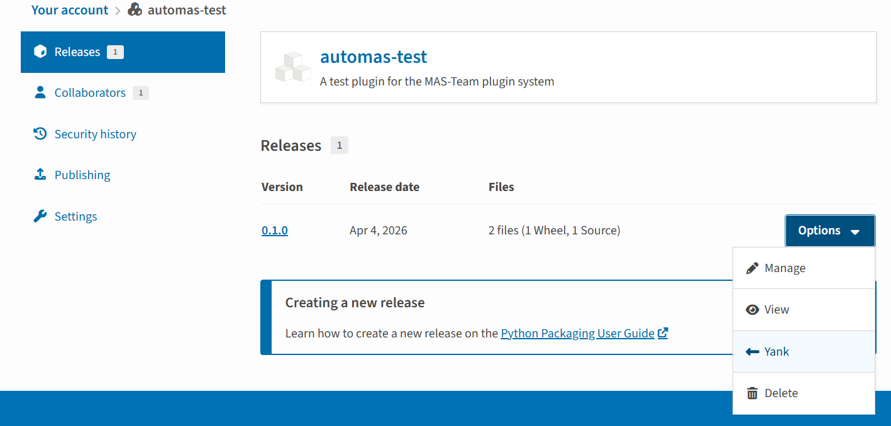

# Publishing Plugins

This document explains how to upload your plugin to PyPI so users can download and install it.

## Show release notes in the plugin market

Keep `CHANGELOG.md` at the root of your plugin repository. Give each release a level-two heading with its PyPI version in brackets.

```markdown
## [1.2.0] - 2026-11-19

- Allow each account to use a different device.
```

Add the public HTTPS link to the file under `[project.urls]` in `pyproject.toml`. Replace the repository and branch in this example with your own.

```toml
[project.urls]
Changelog = "https://github.com/OWNER/REPO/blob/main/CHANGELOG.md"
```

After publishing a new release, open **Changelog** on its PyPI project page and check the file and version heading. The plugin index workflow reads the file, collects notes from the five most recent published versions up to and including the market version, and publishes the catalog to the data site. It skips `Unreleased` and versions you have yet to publish to PyPI.

Once the workflow finishes, download the [public plugin catalog](https://data.auto-mas.top/api/v1/files/auto-mas/Client/plugins/download). Find your package by `package_name` and check its `version` and `changelog`. After refreshing the market, users can expand **Release notes** in **Updates** to see changes since their installed version. The installed plugin's details show the notes for that version. When the app retrieves plugins directly from PyPI or a mirror, it displays no release notes.

## Build the Source Code

If you want to publish to the plugin marketplace, build your source code first. Install `twine` before doing so.

You can install it in a virtual environment or in your system environment. IDEs usually use a virtual environment by default, and we recommend installing `twine` in the virtual environment.

```bash
pip install build twine
```

Enter your plugin directory, for example:

```diff
AUTO-MAS/plugins/ces
```

Run:

```bash
python -m build
```

It generates:

```diff
dist/
 ├── ces-0.1.0.tar.gz
 └── ces-0.1.0-py3-none-any.whl
```

## Register an Account

Register PyPI and TestPyPI accounts:

- **Production**: visit [pypi.org](https://pypi.org/) and register an account.
- **Testing**: visit [test.pypi.org](https://test.pypi.org/) and register an account. This is a separate testing server used to verify your release process without affecting production PyPI.

## Publish the Plugin

Return to your plugin directory and upload your code:

```bash
twine upload dist/*
```

To use TestPyPI:

```bash
twine upload --repository testpypi dist/*
```

## Update the Plugin Version

The initial plugin version is `1.0.0`. After modifying the plugin, update the version number before publishing again.

Open `pyproject.toml` and find:

```toml
version = "1.0.0"
```

Increase the version number manually.

::: tip Reminder

PyPI requires a new version number for every publish. Whenever you update code, increase the version number.

:::

## Mark a Version as Yanked

If you uploaded a plugin to PyPI and later discover that it may cause errors or serious vulnerabilities, you can mark that version as yanked.

1. Log in to PyPI.
2. Open your project page.
3. Click **Manage**.
4. Open **Releases**.
5. Find the version you want to withdraw.
6. Click **Options** next to that version.
7. Select **Yank**.



::: tip What does this do?

Yanked means the version is withdrawn:

- It applies to **a specific version**, not the entire package.
- It marks the version as **not recommended for installation**, for example because of a serious bug.
- `pip install`:
  - Does not select yanked versions by default.
  - Can still install a yanked version if the version is **explicitly specified**.

Yanking prevents accidental installation when no version is specified.

:::

::: warning Can I delete an entire package or version?

- You can delete:
  - A single release version
  - Or the entire package
- But:
  - **It cannot be restored**
  - It breaks dependency chains, so it is generally not recommended

PyPI officially encourages marking versions as deprecated/yanked instead of deleting them.

Unless there is a serious supply-chain attack or malicious code, deleting directly is usually not recommended.

:::
