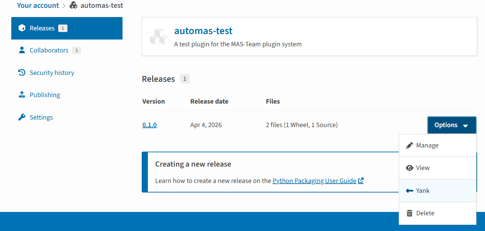

# 发布插件

::: warning
插件系统还在快速变化。本页以主程序 `dev` 分支 2026-11-18 的实现为准。
:::

本文教你把写好的插件发布到 PyPI，并让它出现在 AUTO-MAS 的插件市场里。路径是：你把包发布到 PyPI，数据站定时扫描 PyPI 生成插件目录，客户端读这份目录。

下文沿用[插件开发](./develop)里的示例：发行包 `auto-mas-hello-demo`，插件 ID `hello_demo`。

## 发布前检查

发布前逐项确认：

1. `keywords` 同时含 `auto-mas-plugin` 和且仅有一个 `auto-mas-id:<插件ID>`。
2. `dependencies` 含 `auto-mas-core`。数据站收录时不检查它，但客户端安装时会校验，缺了会报「插件发行包未声明有效的 SDK 依赖」。
3. README 开头有完整的 `auto-mas:i18n` 声明，见下一节。
4. 想让数据站自动发现新包，包名里带 `auto-mas` 或 `automas`，见[数据站目录什么时候收录](#数据站目录什么时候收录)。
5. `version` 比已发布的版本高，使用 PEP 440 格式。

## README 里的市场声明

插件在市场里显示的名称、简介和标签，都写在 README 的第一段 HTML 注释里。`pyproject.toml` 里要有 `readme = "README.md"`，这份 README 会进入发行包元数据，PyPI 的 JSON 接口也会把它原样带出。

```markdown
<!-- auto-mas:i18n
{
  "display_name_i18n": {
    "zh_CN": "你好示例",
    "en": "Hello Demo",
    "ja": "ハロー・デモ"
  },
  "description_i18n": {
    "zh_CN": "最小插件示例",
    "en": "Minimal plugin example",
    "ja": "最小のプラグイン例"
  },
  "tags_i18n": {
    "zh_CN": ["示例"],
    "en": ["Example"],
    "ja": ["サンプル"]
  }
}
-->

# Hello Demo
```

三个字段都必填：

| 字段 | 内容 |
| --- | --- |
| `display_name_i18n` | 语言到名称的映射，至少一个非空条目 |
| `description_i18n` | 语言到简介的映射，至少一个非空条目 |
| `tags_i18n` | 语言到标签数组的映射，至少一种语言，数组里都是字符串 |

规则：

- 注释必须是 README 的第一块内容，前面只能有空白。
- 注释内容必须是合法 JSON。
- 语言键用 `zh_CN`、`en`、`ja`。展示时按用户语言取，取不到就回退到别的语言。宿主只要求每个字段至少有一种语言；官方适配器仓库的 CI 要求 `zh_CN`、`en`、`ja` 三种齐全，建议照做。
- `project.description` 写普通简介，`project.urls` 只放真实的 HTTP/HTTPS 链接。文档、主页、源码仓库地址分别取 `Documentation`/`Docs`、`Homepage`/`Home`、`Repository`/`Source`/`Source Code`/`GitHub` 这几个标签。

声明缺失、不在开头、JSON 无效或三个字段有一个不满足时：

| 位置 | 后果 |
| --- | --- |
| 数据站目录 | 不收录这个包 |
| 客户端读 PyPI 兜底时 | 市场里不显示这个条目 |
| 本地源码和已安装的插件 | 照常工作，但用插件 ID 当名称、`description` 当简介，不显示标签 |

::: warning 已收录的插件改坏声明
一个已被收录的包，发布的新版本如果缺了关键词或声明失效，数据站那一轮刷新会整体中止并保留旧目录。新版本不会出现，其他插件的更新也会被一起拖住，直到有人修好。发布前务必自检。
:::

## 构建源代码

你需要先安装构建工具和 twine。可以装在虚拟环境里，也可以装在系统环境里，我们推荐虚拟环境。

```bash
pip install build twine
```

进入插件工程根目录，例如：

```text
AUTO-MAS/plugins/hello_demo
```

运行：

```bash
python -m build
```

它会生成：

```text
dist/
 ├── auto_mas_hello_demo-0.1.0.tar.gz
 └── auto_mas_hello_demo-0.1.0-py3-none-any.whl
```

用 `uv build` 也一样。构建后检查包元数据：

```bash
twine check --strict dist/*
```

## 注册账号

注册 PyPI 和 TestPyPI 账号：

- **正式环境**：访问 [pypi.org](https://pypi.org/) 注册账号。
- **测试环境**：访问 [test.pypi.org](https://test.pypi.org/) 注册账号。这是一个独立的测试服务器，用来验证你的发布流程，不会影响正式的 PyPI。

::: warning
数据站只扫描 [pypi.org](https://pypi.org/)。发到 TestPyPI 的包不会被收录进插件市场。
:::

## 发布插件

### 手动上传

回到插件目录，上传：

```bash
twine upload dist/*
```

如果你希望使用 TestPyPI：

```bash
twine upload --repository testpypi dist/*
```

手动上传需要 PyPI 的 API Token，注意妥善保管。

### 推荐：Trusted Publishing

更推荐用 GitHub Actions 配合 PyPI 的 Trusted Publishing：CI 通过 OIDC 向 PyPI 证明身份，仓库里不用存 Token。官方的 MAA、奇想盒适配器都是这么发的，完整步骤见 [MAA 适配器发布说明](https://github.com/AUTO-MAS-Project/AUTO-MAS-MAA-Adapter/blob/master/docs/PUBLISHING.md)。要点：

1. 在 PyPI 账户的 **Publishing** 页面添加 pending publisher。首次发布成功时才会创建 PyPI 项目，pending publisher 不会预留包名。
   - PyPI project name：你的发行包名，如 `auto-mas-hello-demo`
   - Owner / Repository name：GitHub 仓库的所有者和仓库名
   - Workflow name：工作流文件名，如 `publish.yml`，不是工作流的显示名称
   - Environment name：`pypi`
2. 在 GitHub 仓库 Settings → Environments 创建名为 `pypi` 的环境，可以设置维护者审核。
3. 工作流只给发布任务授予 `id-token: write`。分支推送和 PR 只构建、校验，只有 `v*` 标签才上传。
4. 标签必须和 `pyproject.toml` 的版本一致：版本 `0.1.0` 打标签 `v0.1.0`。

一个最小的 `.github/workflows/publish.yml`：

```yaml
name: 构建并发布 PyPI 包

on:
  push:
    tags: ["v*"]

permissions:
  contents: read

jobs:
  build:
    runs-on: ubuntu-latest
    steps:
      - uses: actions/checkout@v4
      - uses: actions/setup-python@v5
        with:
          python-version: "3.12"
      - name: 检查标签与包版本一致
        env:
          RELEASE_TAG: ${{ github.ref_name }}
        run: |
          python - <<'PY'
          import os
          import tomllib
          from pathlib import Path

          version = tomllib.loads(Path("pyproject.toml").read_text(encoding="utf-8"))["project"]["version"]
          if os.environ["RELEASE_TAG"] != f"v{version}":
              raise SystemExit("发布标签必须与 pyproject.toml 的版本一致")
          PY
      - run: python -m pip install build twine
      - run: python -m build
      - run: python -m twine check --strict dist/*
      - uses: actions/upload-artifact@v4
        with:
          name: python-distributions
          path: dist/*
          if-no-files-found: error

  publish:
    needs: build
    runs-on: ubuntu-latest
    environment:
      name: pypi
    permissions:
      id-token: write
    steps:
      - uses: actions/download-artifact@v4
        with:
          name: python-distributions
          path: dist/
      - uses: pypa/gh-action-pypi-publish@release/v1
```

发布命令：

```bash
git tag v0.1.0
git push origin v0.1.0
```

官方适配器的工作流还会在构建后校验 wheel 里的项目链接和 `auto-mas:i18n` 声明，可以参考 [奇想盒适配器的 publish.yml](https://github.com/AUTO-MAS-Project/AUTO-MAS-Whimbox-Adapter/blob/master/.github/workflows/publish.yml)。

::: tip
市场安装时，宿主会向依赖解析器提供自带的 `auto-mas-core`。**不需要**先把 SDK 发布到 PyPI，也不要从你的 `dependencies` 里删掉它。只有用户绕过插件中心、直接 `pip install` 你的包时，才需要另外提供兼容的 SDK。
:::

## 更新插件版本

版本号写在 `pyproject.toml` 里：

```toml
version = "0.1.0"
```

修改过插件后，把它手动提高再重新发布，使用 PEP 440 格式，例如 `0.1.1`。

::: tip 提醒
PyPI 要求必须新增版本号才能发布，因此无论如何，只要你更新了代码，就必须增加版本号。客户端也是靠版本号比较新旧来提示升级的。
:::

## 验收

发布后按下面三步逐项确认。前一步没过，不要往后看。

### ① PyPI 发布成功

确认 PyPI 上有新版本，且数据站读取到的元数据正确。数据站读的是 PyPI 的 JSON 接口，你也可以直接看它：

```powershell
$info = (Invoke-RestMethod https://pypi.org/pypi/auto-mas-hello-demo/json).info
$info.version
$info.keywords
$info.description.Substring(0, 40)
```

应该看到新版本号，`keywords` 含 `auto-mas-plugin, auto-mas-id:hello_demo`，`description` 以 `<!-- auto-mas:i18n` 开头。

### ② 数据站目录已收录

打开客户端使用的目录，在 `plugins` 里找你的包：

```powershell
(Invoke-RestMethod https://data.auto-mas.top/api/v1/files/auto-mas/Client/plugins/download).plugins |
    Where-Object package_name -eq 'auto-mas-hello-demo' |
    Select-Object package_name, plugin_name, version
```

版本号是你刚发布的，说明数据站已更新。没有结果时，看下一节。

### ③ 客户端里显示和安装正常

1. 用一个干净的测试环境，且不要在 `plugins/` 下留着同一个插件的源码。本地源码会覆盖已安装的发行包，不能证明 PyPI 安装成功。
2. 打开「插件市场」。进入页面时客户端会自动刷新目录，也可以点「刷新」。
3. 找到你的插件，核对名称、简介、标签和版本，点安装。安装过程中可能提示重启后端。
4. 回到「插件中心」，核对包名、版本、来源（「插件市场」）和状态，启用并确认功能正常。

::: tip
如果刚发布就装不上，可能是依赖解析用的镜像还没同步新版本。过一会儿再试，不要误判成发布失败。
:::

## 数据站目录什么时候收录

目录由 [AUTO-MAS-Plugin-Index](https://github.com/AUTO-MAS-Project/AUTO-MAS-Plugin-Index) 仓库的 GitHub Actions 生成，不会安装或执行你的插件，只读 PyPI 上的元数据。

| 情况 | 时机 |
| --- | --- |
| 已收录插件发布了新版本 | 每 30 分钟刷新一次，之后还要等目录上传到数据站并公开 |
| 全新的包 | 每天 UTC 00:07（北京时间 08:07）扫描一次 PyPI 上的新候选。GitHub 定时任务可能延迟，维护者也可以手动运行 `discover` 立即扫描 |

新包能不能被发现，看包名：

- 自动发现靠包名启发：包名（忽略大小写，`-`、`_`、`.` 视为相同）里要含 `auto-mas` 或 `automas`。
- 包名不带这两个词的，只能由维护者把包名补进该仓库的 `config/packages.json`。需要的话请联系维护者。
- 补录或自动发现只是让它进入候选。最终收不收，仍看发行元数据里的两个关键词和完整的 `auto-mas:i18n` 声明。随主程序提供的 `auto_mas_core` 不会进入市场目录。

已被收录或补录的包，读取失败或声明失效会让这一轮刷新中止、旧目录保持可用；还没被收录的未知候选声明不对，只会被跳过。已收录、且不在补录清单里的包，只有在 PyPI 明确返回 404 时才会被移除；补录清单里的包返回 404 同样会让这一轮中止。

### 客户端的刷新行为

客户端进入市场页会自动刷新目录，点「刷新」也会。每次刷新先读数据站目录（5 秒超时）。读到后直接用它替换本地的市场目录，**不会再去 PyPI 补查没被收录的新包**。只有数据站目录不可用（网络失败、超时、内容校验不过）时，才回退到 PyPI 和镜像的逐包检索。

所以：PyPI 上已经有了，但数据站目录还没收录，市场里就看不到它。耐心等上面的收录时机，或联系维护者补录。

::: tip 自测还没收录的新包
启动后端前，把环境变量 `AUTO_MAS_PLUGIN_INDEX_URL` 设为一个不可用的 HTTPS 地址（例如 `https://127.0.0.1:9/`），数据站目录读取失败，客户端就会回退到 PyPI 检索。回退检索同样靠包名找新包，包名里要含 `auto-mas` 或 `automas`。这只用于开发者自测，只影响你自己的后端。
:::

## 标记停用版本

如果你上传了插件到 PyPI，事后发现你的插件可能导致错误或严重漏洞，你可以将它标记为 yank：

1. 登录 PyPI
2. 进入你的项目页面
3. 点击 **“管理（Manage）”**
4. 进入 **“发行版（Releases）”**
5. 找到你要撤回的版本
6. 点击该版本旁边的 **“选项（Option）”**
7. 选择 Yank



::: tip 有什么用？

yanked 表示撤回版本：

- 针对**某个版本**（不是整个包）
- 表示这个版本**不推荐安装**（比如有严重 bug）
- `pip install`：
  - 默认不会选中 yanked 版本
  - 但如果你**明确指定版本号**，仍然可以安装

使用 yank，可以避免不指定版本导致的误安装。

:::

::: warning 我能不能删了整个包或版本？

- 你可以删除：
  - 单个 release（版本）
  - 或整个 package
- 但：
  - **不可恢复**
  - 破坏依赖链（所以一般不推荐）

PyPI 官方更鼓励 **不要删，而是标记弃用**。

除非遇到严重的供应链攻击或病毒代码，一般来说不建议你直接删了。

:::
